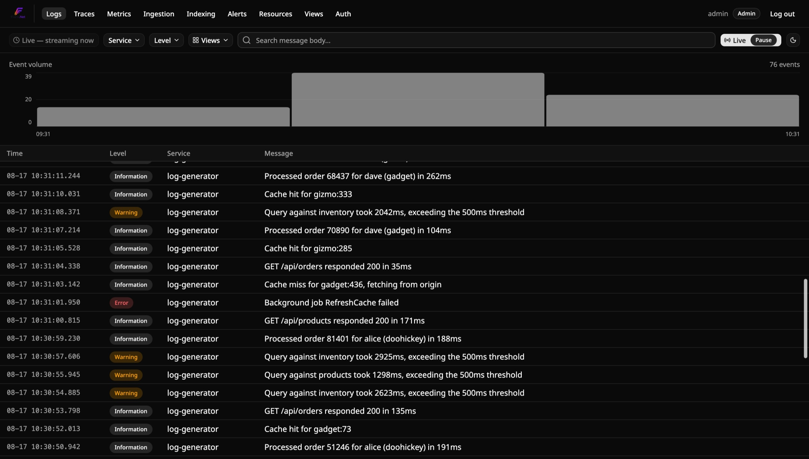

<!-- Translated (fr) from README.md · source-sha256:c7ad91af7c50acda · hand-translated by Claude, not generated by scripts/translate-docs.py - edit the source file and retranslate if it changes, don't machine-retranslate over this. -->

<p align="center">
  
</p>

<!-- logo.png is packed into both NuGet packages (Flare.Aspire/Flare.Hosting.Aspire csproj
     PackageIcon + this README as PackageReadmeFile), both at the package root - a plain
     relative "logo.png" reference resolves correctly on GitHub (repo root) and on the
     nuget.org-rendered README (package root) without any path differences. -->

# Flare.Net

[](https://github.com/aminparsa18/Flare.Net/actions/workflows/ci.yml)
[](https://github.com/aminparsa18/Flare.Net/actions/workflows/docker-publish.yml)
[](https://github.com/aminparsa18/Flare.Net/actions/workflows/docs-links.yml)
[](LICENSE)
[](https://www.nuget.org/packages/CommunityToolkit.Aspire.Hosting.Flare)
[](https://www.nuget.org/packages/Flare.Cli)
[](https://www.npmjs.com/package/@apardev/flare-cli)
[](https://github.com/aminparsa18/Flare.Net/releases/latest)
[](https://github.com/aminparsa18/Flare.Net/actions/workflows/helm-lint.yml)
[](https://hub.docker.com/u/apardev)
[](https://www.nuget.org/packages/Flare.Cli)
[](https://dotnet.microsoft.com/)
[](https://opentelemetry.io/)
[](https://github.com/aminparsa18/Flare.Net/stargazers)
[](https://github.com/aminparsa18/Flare.Net/commits/main)

**Langues :** [English](README.md) &nbsp;|&nbsp; [简体中文](README.zh-CN.md) &nbsp;|&nbsp; [Русский](README.ru.md) &nbsp;|&nbsp; [Français](README.fr.md)

**[📖 Lire la documentation →](https://aminparsa18.github.io/Flare.Net/fr/)**

Une plateforme d'observabilité auto-hébergée, native OpenTelemetry, pour .NET — logs, traces et métriques traités comme des éléments de première classe, corrélés en un seul endroit, avec des règles d'alerte basées sur des seuils/requêtes qui notifient par webhook/Slack, Telegram ou e-mail en cas de dépassement.

**Pensez Seq ou Datadog — mais entièrement open source (MIT), auto-hébergé, et compatible OTLP nativement sans agent propriétaire ni SDK à installer.**

## OpenTelemetry avant tout

Votre application → **OTLP** → Flare. C'est toute l'histoire de l'ingestion — pas de format propriétaire, pas d'agent démon. Si vous êtes déjà instrumenté avec OpenTelemetry, Flare peut le consommer directement.

**[Essayer la démo en ligne →](https://176-223-135-205.sslip.io)** — un Flare en fonctionnement qui reçoit les logs, traces et métriques d'une boutique d'exemple.



## Ce que propose Flare

| | |
|---|---|
| **Logs** | Recherche, filtrage, live tail, propriétés structurées |
| **Traces** | Traçage distribué avec corrélation logs/traces |
| **Métriques** | Explorez les métriques OpenTelemetry aux côtés des logs et des traces |
| **Alertes** | Règles basées sur des seuils/requêtes avec webhook, Slack, Telegram et e-mail |
| **Ingestion** | Récepteur OTLP et santé du pipeline |
| **Indexation** | Index ClickHouse et diagnostics de requêtes/stockage |
| **Authentification** | Comptes locaux, Entra ID, Active Directory/LDAP, OIDC et en-têtes de confiance de proxy inverse |
| **Vues** | Recherches enregistrées et vues réutilisables |
| **Assistants IA** | Serveur MCP en lecture seule (`flare mcp`) pour que Claude Code, Cursor et VS Code interrogent logs, traces, métriques et alertes |

## Pourquoi Flare ?

- **Natif OpenTelemetry** — pas de protocole d'ingestion propriétaire ; envoyez directement de la télémétrie OTLP standard.
- **Auto-hébergé** — votre télémétrie reste dans votre infrastructure.
- **Conçu pour .NET** — intégration .NET/Aspire de première classe sans nécessiter un écosystème d'agents séparé.
- **Un seul endroit pour la télémétrie** — logs, traces et métriques sont corrélés plutôt que traités comme des produits séparés.
- **Déploiement simple** — exécutez-le via Aspire, Docker Compose ou le CLI Flare.

## Démarrage

Ce qui diffère, c'est la façon dont vous exécutez Flare lui-même. Choisissez-en une :

- **Vous utilisez déjà .NET Aspire ?**
  ```csharp
  // AppHost
  var flare = builder.AddFlare("flare", builder.AddClickHouse("clickhouse"), builder.AddRedis("redis"));
  builder.AddDotnetProject("myapi", "../MyApi/MyApi.csproj").WithOtlpExporter(flare).WaitFor(flare);
  ```
  `aspire add CommunityToolkit.Aspire.Hosting.Flare` (Aspire 17+, issu de l'Aspire Community Toolkit) — Flare rejoint votre AppHost en tant que ressource, il démarre donc, s'arrête et est découvert par vos autres ressources de la même façon que tout le reste de votre graphe. Détails : [Exécution avec .NET Aspire](https://aminparsa18.github.io/Flare.Net/fr/how-to/deploy/run-with-aspire.html).

- **Vous n'utilisez pas Aspire et voulez l'exécuter de façon autonome ?**
  ```sh
  docker compose up
  ```
  à la racine du dépôt, avec des valeurs par défaut fonctionnelles pour chaque port et identifiant (copiez [.env.example](.env.example) vers `.env` pour en changer). Détails : [Exécution autonome](https://aminparsa18.github.io/Flare.Net/fr/how-to/deploy/run-standalone.html).

- **Juste en train d'évaluer — pas de dépôt cloné, pas de SDK .NET ?**
  ```sh
  curl -fsSL https://raw.githubusercontent.com/aminparsa18/Flare.Net/main/scripts/install.sh | bash
  ```
  Installe Docker s'il est absent, puis récupère et démarre la même pile autonome à partir des images publiées. Détails : [Exécution autonome](https://aminparsa18.github.io/Flare.Net/fr/how-to/deploy/run-standalone.html#installation-rapide-sans-prérequis).

- **Vous voulez une seule instance persistante partagée entre plusieurs projets locaux indépendants ?**
  ```sh
  dotnet tool install --global Flare.Cli
  flare start
  ```
  Un CLI global qui gère la même pile Docker depuis n'importe où, sans nécessiter de cloner le dépôt. Détails : [Exécution avec le CLI](https://aminparsa18.github.io/Flare.Net/fr/how-to/deploy/run-with-cli.html).

Quel que soit le chemin choisi, le tableau de bord démarre sur [http://localhost:7777](http://localhost:7777). L'authentification est **désactivée par défaut** — la page Logs est accessible dès le démarrage. Activez la connexion (comptes locaux, Microsoft Entra ID, Active Directory, OpenID Connect ou en-têtes de confiance de proxy inverse) depuis la page `/auth` quand vous êtes prêt ; voir [Configurer l'authentification](https://aminparsa18.github.io/Flare.Net/fr/how-to/admin/configure-authentication.html).

Ensuite, pointez un logger vers Flare — des extraits OTLP prêts à copier-coller pour Serilog, NLog, ZLogger et `Microsoft.Extensions.Logging` se trouvent dans [Exécution autonome](https://aminparsa18.github.io/Flare.Net/fr/how-to/deploy/run-standalone.html#pointer-votre-logger-vers-flare) (ou [Exécution avec .NET Aspire](https://aminparsa18.github.io/Flare.Net/fr/how-to/deploy/run-with-aspire.html#3-envoyer-la-télémétrie-de-vos-services-à-flare) avec Aspire). Pour tout le reste — Python, Node.js, Java, Go, Kubernetes, pipelines DevOps, un agent de collecte de logs, ou le scraping Prometheus — la page **Data sources** du tableau de bord (menu déroulant de navigation, ou l'état vide de la page Logs) propose le même genre d'extraits prêts à copier-coller.

Vous dépassez les capacités d'un seul nœud ClickHouse ? Il existe une configuration de cluster multi-nœuds optionnelle — voir [Exécution en mode cluster](https://aminparsa18.github.io/Flare.Net/fr/how-to/deploy/run-cluster-mode.html).

Vous voulez que votre assistant IA lise votre télémétrie ? `flare mcp` est un serveur [MCP](https://modelcontextprotocol.io) en lecture seule — voir [Laisser un assistant IA interroger Flare](https://aminparsa18.github.io/Flare.Net/fr/how-to/integrations/connect-ai-assistants.html).

### Applications mobiles (.NET MAUI)

Vous développez une application mobile ? [`Flare.Maui`](src/Flare.Maui) (aperçu, pas encore sur NuGet) ajoute `builder.UseFlare(...)` à une application .NET MAUI : export OTLP/HTTP avec file hors ligne, attributs d'appareil et de session, spans `HttpClient` et de navigation Shell, capture des exceptions non gérées — voir [Envoyer la télémétrie d'une application .NET MAUI à Flare](https://aminparsa18.github.io/Flare.Net/fr/how-to/instrument/send-maui-telemetry.html).

## Développement local

Docker autonome n'est pas la boucle de développement locale — voir [Flare.AppHost](src/Flare.AppHost) (.NET Aspire) pour cela, et le README de chaque projet (par exemple [src/dashboard/README.md](src/dashboard/README.md)) pour l'exécuter individuellement.

## État actuel

Flare est activement développé et fournit actuellement :

- Logs
- Traces
- Métriques
- Alertes
- Ingestion OTLP
- Santé du pipeline
- Diagnostics d'indexation
- Recherches enregistrées
- Authentification
- Intégration Aspire
- Déploiement Docker
- CLI Flare

### Suite

Voir [docs-internal/planning/roadmap.md](docs-internal/planning/roadmap.md) pour ce qui est actuellement en cours — les politiques de rétention et le stockage froid vers un stockage objet compatible S3 en tête de liste.

Architecture complète : [Architecture](https://aminparsa18.github.io/Flare.Net/fr/explanation/architecture.html). Décisions de conception : [docs-internal/adr/](docs-internal/adr/).

## Contribuer

Voir [CONTRIBUTING.md](CONTRIBUTING.md).

## Licence

[MIT](LICENSE)

## Soutenir le projet

Si Flare vous est utile, vous pouvez soutenir son développement par un don via [PayPal](https://www.paypal.com/paypalme/aminparsa18).
