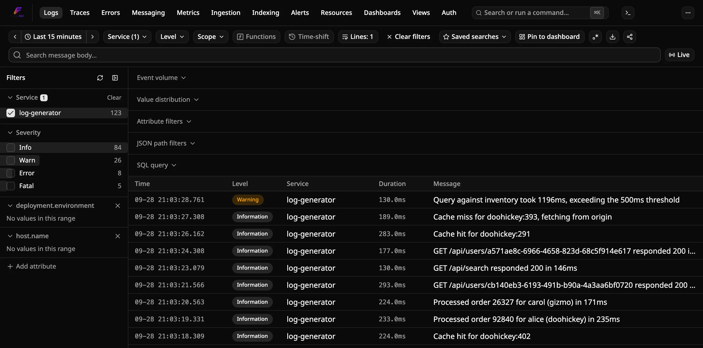
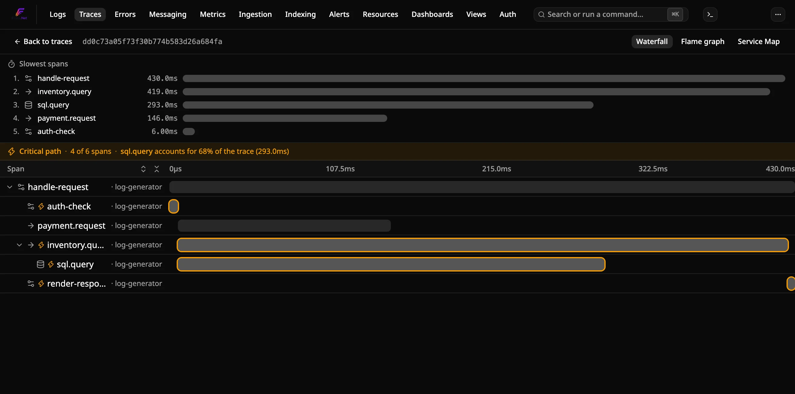
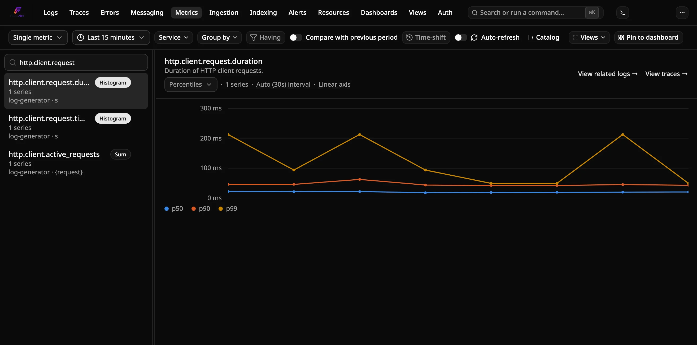
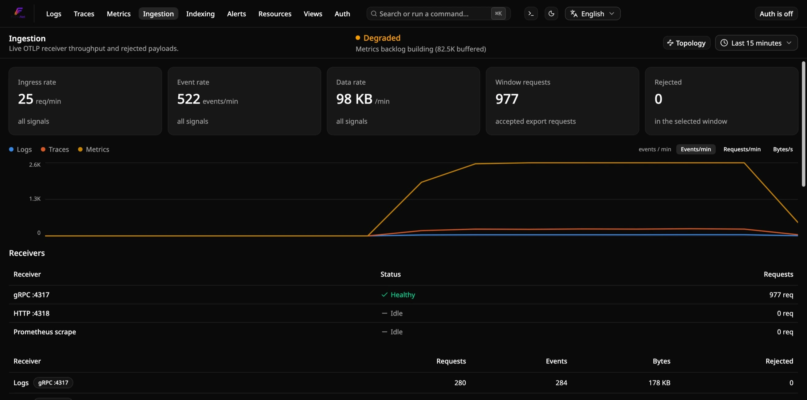
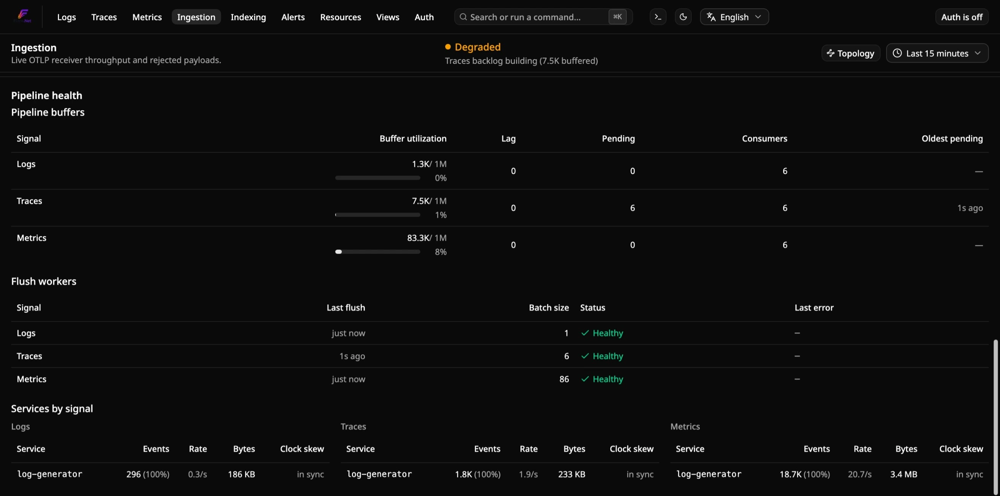
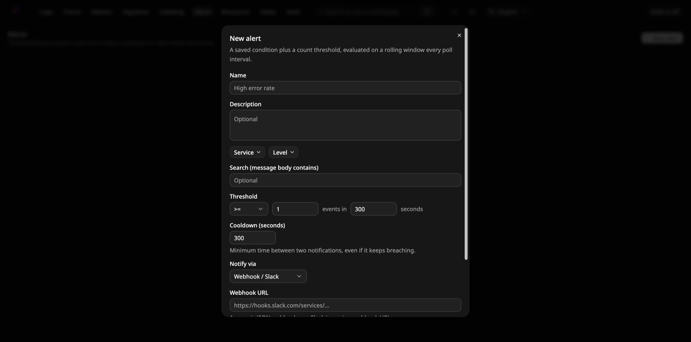
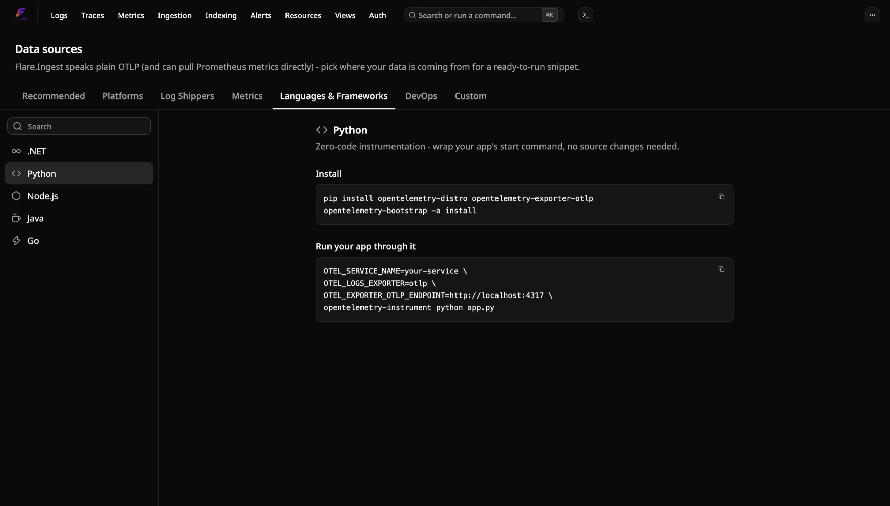
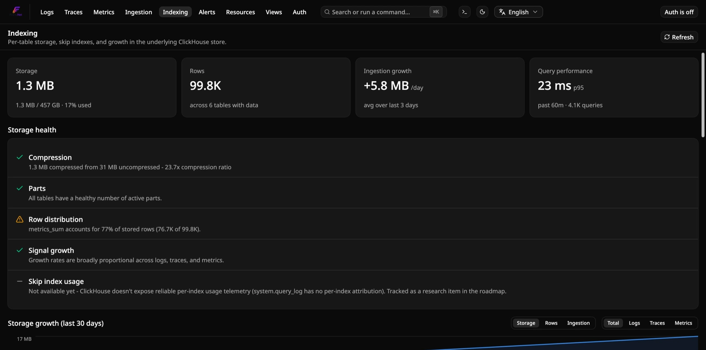
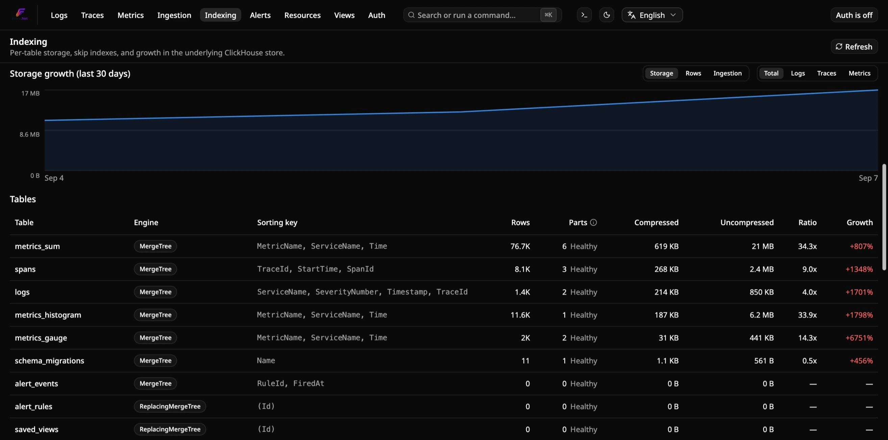
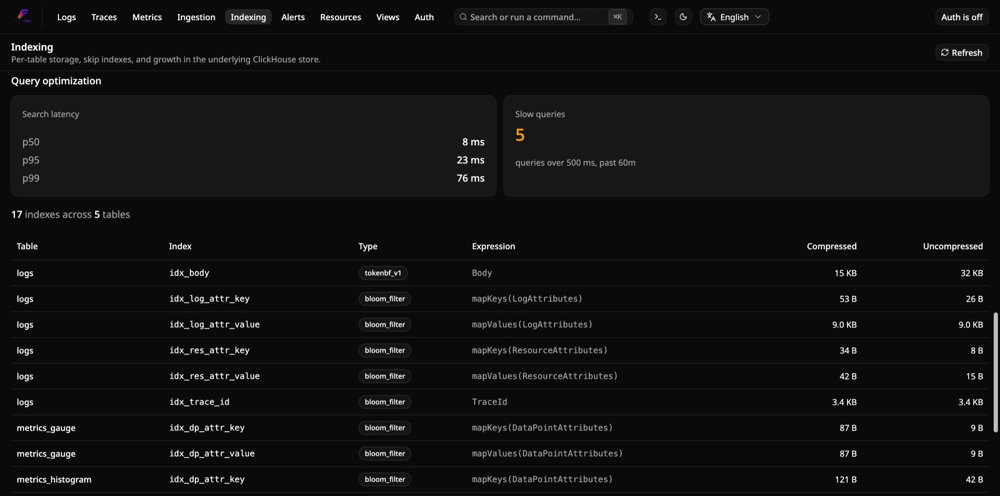

<!-- Translated (fr) from docs/explanation/architecture.md · source-sha256:398a93dfeb49de44 · hand-translated by Claude, not generated by scripts/translate-docs.py - edit the source file and retranslate if it changes, don't machine-retranslate over this. -->

# Architecture

Flare est une plateforme d'observabilité auto-hébergée, native OpenTelemetry,
pour .NET — logs, traces, métriques et profils traités comme des éléments de
première classe, corrélés en un seul endroit, avec des alertes (seuils,
anomalies, taux de consommation du budget d'erreur), un suivi des erreurs et
des tableaux de bord par-dessus. Cette page explique pourquoi elle est conçue
ainsi ; voir [`../reference/`](../reference/) pour les valeurs exactes et
[`../how-to/`](../how-to/) pour les instructions pas à pas.

## Pourquoi Flare existe

Le paysage des outils de logs auto-hébergés pour les développeurs .NET
oblige à choisir entre deux frustrations : **Seq** — un moteur solide, mais
une interface datée et un palier gratuit limité à un seul utilisateur — et
**Grafana / SigNoz / OpenObserve** — puissants et natifs OTel, mais
lourds à exploiter, génériques OTel plutôt qu'adaptés à l'expérience de
développement .NET, et conçus pour des équipes infra/SRE plutôt que pour
un développeur qui veut simplement lire la télémétrie de son application
de façon agréable.

Le pari de Flare : **le problème du stockage/des requêtes est déjà résolu
par ClickHouse (voir
[ADR-0013](../../docs-internal/adr/0013-clickhouse-as-storage-engine.md)).
Le facteur différenciant est un excellent tableau de bord et une mise en
place de deux minutes.** C'est là que va l'effort — Flare ne cherche pas à
atteindre la parité fonctionnelle avec une suite d'observabilité complète ;
voir [Non-objectifs](#non-objectifs) ci-dessous.

## Principes de conception

1. **Un seul protocole en entrée : OTLP.** Pas d'adaptateur d'ingestion par
   bibliothèque de logs — chaque logger pris en charge, et chaque autre
   signal, atteint Flare via le protocole OpenTelemetry. La seule autre voie
   d'entrée, un récepteur de scrape Prometheus, existe pour les exporteurs
   qui ne parlent que Prometheus. Voir
   [ADR-0012](../../docs-internal/adr/0012-otlp-only-ingestion.md).
2. **Le stockage est un problème résolu.** ClickHouse est le backend, bien
   enveloppé plutôt que réinventé. Voir
   [ADR-0013](../../docs-internal/adr/0013-clickhouse-as-storage-engine.md).
3. **Le tableau de bord est le produit.** Le frontend bénéficie d'une
   attention de premier ordre — il doit avoir un look et une sensation
   différents de Seq ou d'un panneau Grafana. Voir
   [ADR-0001](../../docs-internal/adr/0001-sveltekit-dashboard.md) pour la
   pile technique derrière.
4. **Un minimum de friction pour essayer.** `docker compose up` pour le
   chemin autonome ; un CLI `flare` pour une instance persistante. Si
   essayer Flare prend plus de deux minutes, c'est un bug dans l'expérience
   de prise en main.
5. **Une DX pensée d'abord pour .NET, mais pas exclusive à .NET.**
   L'expérience de prise en main est adaptée aux loggers .NET, à Aspire et à
   .NET MAUI, mais comme l'ingestion est du OTLP pur, les équipes
   polyglottes ne sont pas exclues.
6. **Calculer une fois, lire souvent.** Le travail que chaque chargement de
   page répéterait (métriques RED, carte des services, compteurs de SLO,
   motifs de logs) est fait à l'insertion, et chaque requête est plafonnée
   pour qu'un mauvais filtre ne puisse pas mettre la base à genoux. Voir
   [Comment Flare stocke et interroge la télémétrie](how-flare-stores-and-queries-telemetry.fr.md).
7. **Vous gardez les données.** Auto-hébergé signifie que la télémétrie reste
   sur votre infrastructure, et tout ce qui pourrait en sortir (la
   vérification de mise à jour, les fournisseurs d'IA, les canaux de
   notification, le transfert) est optionnel ou visible. Voir
   [Résidence des données et confidentialité](data-residency-and-privacy.fr.md).
8. **Discipline de périmètre.** Livrer un ensemble de fonctionnalités
   restreint et ciblé. Les idées spéculatives vont dans
   [la feuille de route](../../docs-internal/planning/roadmap.md), pas
   dans ce qui est livré actuellement.

## Le pipeline de l'ingestion au tableau de bord

```
  ┌─────────────────────────────────────────────┐
  │  Vos applications / services                 │
  │  Serilog · NLog · ZLogger · MS ILogger ·     │
  │  toute source OTLP (Go, Node, Python,        │
  │  navigateurs, .NET MAUI, OpenTelemetry       │
  │  Collector, ...)                             │
  └───────────────────────┬─────────────────────┘
                          │  OTLP  (gRPC :4317 / HTTP :4318)
                          │  (+ scrape Prometheus, en pull)
                          ▼
  ┌─────────────────────────────────────────────┐
  │  Flare.Ingest  (ASP.NET Core)                │
  │  • Récepteur OTLP (logs, traces, métriques,  │
  │    profils)                                  │
  │  • Authentification par clé d'ingestion et   │
  │    limites                                   │
  │  • Normalisation → modèle d'événement interne│
  │  • Règles de masquage/extraction,            │
  │    échantillonnage des traces                │
  │  • Buffer (un Redis Stream par signal)       │
  │  • Workers de flush : insertion par lots,    │
  │    puis ack                                  │
  └───────────────────────┬─────────────────────┘
                          │  insertions par lots
                          ▼
  ┌─────────────────────────────────────────────┐
  │  ClickHouse   (stockage colonnaire)          │
  │  télémétrie · pré-agrégats · tables de config│
  └───────────┬───────────────────────┬─────────┘
              │  SQL                  │  SQL
              ▼                       ▼
  ┌──────────────────────────┐  ┌────────────────────────┐
  │  Flare.Api               │  │  Flare.AlertWorker     │
  │  • Recherche / agrégation│  │  • Évalue les règles   │
  │  • Live tail (WebSocket) │  │    d'alerte            │
  │  • CRUD de config, auth  │  │  • Envoie les          │
  │  • MCP, API compatibles  │  │    notifications       │
  │    Prometheus/Loki/Tempo │  │  • Sondes synthétiques,│
  │                          │  │    rapports, archive   │
  └────────────┬─────────────┘  └────────────────────────┘
               │  HTTP / WS
               ▼
  ┌─────────────────────────────────────────────┐
  │  Flare.Dashboard  (SPA)                      │
  │  • Logs, traces, erreurs, métriques,         │
  │    alertes, tableaux de bord, etc.           │
  │  • Live tail · vues enregistrées · graphiques│
  └─────────────────────────────────────────────┘
```

Trois chemins de lecture partent du buffer Redis ou de ClickHouse, et aucun
ne ralentit l'ingestion : les requêtes vont à ClickHouse, le live tail lit le
même Redis Stream que l'ingestion alimente (les nouvelles lignes apparaissent
donc avant d'être écrites dans ClickHouse), et l'évaluation des alertes
tourne dans son propre processus.

| Composant | Techno | Responsabilité |
|---|---|---|
| `Flare.Ingest` | ASP.NET Core | Termine l'OTLP (gRPC + HTTP) pour les logs, traces, métriques et profils, plus les points de terminaison de captures d'écran et de retours utilisateur qu'utilise `Flare.Maui`. Authentifie les clés d'ingestion et applique leurs limites, mappe vers le modèle d'événement interne, applique les [règles de pipeline](../how-to/data/manage-pipeline-rules.fr.md), le clustering des motifs de logs et l'échantillonnage des traces, met en buffer, insère par lots dans ClickHouse. Scrape aussi des points de terminaison Prometheus et peut transférer la télémétrie vers un autre point de terminaison OTLP |
| Redis | conteneur | Buffer durable entre l'ingestion et ClickHouse — voir [ADR-0002](../../docs-internal/adr/0002-redis-streams-buffering.md). C'est aussi le cache des résultats de requêtes ([ADR-0029](../../docs-internal/adr/0029-query-result-caching.md)) et le verrou et les marqueurs qui font tourner l'évaluation des alertes sur un seul réplica par cycle |
| ClickHouse | conteneur | Stockage des logs/traces/métriques/profils et moteur de requêtage, tables pré-agrégées lues par les pages Services et SLO, et tables de configuration (règles d'alerte et leur historique, tableaux de bord, vues enregistrées, SLO, pages de statut) — voir [ADR-0013](../../docs-internal/adr/0013-clickhouse-as-storage-engine.md) |
| `Flare.Api` | ASP.NET Core | Requêtage/recherche/agrégation sur ClickHouse ; point de terminaison de streaming pour le live tail ; CRUD pour tout ce qui est configurable ; points de terminaison d'authentification ; le point de terminaison [MCP](../how-to/integrations/connect-ai-assistants.fr.md) en lecture seule et des API de requêtage compatibles Prometheus, Loki et Tempo |
| `Flare.AlertWorker` | worker ASP.NET Core | Évalue les règles d'alerte et envoie les notifications, exécute les sondes synthétiques et (si activé) produit les rapports de tableaux de bord planifiés et archive la télémétrie vers un stockage compatible S3. Séparé de `Flare.Api` pour qu'un déploiement de l'API ne mette pas les alertes en pause — voir [ADR-0018](../../docs-internal/adr/0018-alert-worker-extraction.md) |
| `Flare.Identity` | bibliothèque | Utilisateurs, sessions, jetons d'accès personnels, clés d'ingestion, projets, journal d'audit et source maps. Liée à `Flare.Ingest` et à `Flare.Api`, stockée dans un fichier SQLite embarqué par défaut ou dans Postgres — voir [ADR-0004](../../docs-internal/adr/0004-embedded-sqlite-for-identity.md) et [ADR-0111](../../docs-internal/adr/0111-pluggable-identity-store-postgres.md) |
| `Flare.Dashboard` | SvelteKit (Svelte 5, runes) + Tailwind + shadcn-svelte | L'interface — la raison pour laquelle on vient. Voir [ADR-0001](../../docs-internal/adr/0001-sveltekit-dashboard.md). |
| `Flare.AppHost` | .NET Aspire | Orchestration locale de tout ce qui précède |
| `Flare.Cli`, `Flare.Mcp` | outil global .NET | Le CLI `flare` qui gère une instance persistante et l'interroge depuis un terminal ; `flare mcp` expose les mêmes outils en lecture seule via stdio |
| `Flare.Maui` | paquet NuGet | `UseFlare()` pour les applications .NET MAUI : sessions, plantages, blocages, performance au démarrage, fil d'Ariane — voir [ADR-0166](../../docs-internal/adr/0166-maui-sdk.md) |

Flare reste quatre choses à exécuter (Ingest, Api, AlertWorker, Dashboard) et
deux stockages (ClickHouse, Redis) ; Identity y ajoute un fichier SQLite, pas
un cinquième conteneur. Un stockage objet optionnel (RustFS dans les
configurations Compose et Aspire fournies) soutient le
[niveau froid](retention-and-tiering.fr.md) et l'archive, et un proxy de
socket Docker optionnel, en lecture seule, alimente la page Resources.

Chaque logger .NET compatible OTLP atteint le récepteur d'ingestion de
Flare de la même façon — voir
[`../how-to/deploy/run-standalone.md`](../how-to/deploy/run-standalone.fr.md) pour un
extrait prêt à copier-coller par logger
(`Microsoft.Extensions.Logging`/ZLogger via `OpenTelemetry.Exporter.OpenTelemetryProtocol`,
Serilog via `Serilog.Sinks.OpenTelemetry`, NLog via
`NLog.Targets.OpenTelemetryProtocol`) et
[`../reference/otlp-logger-versions.md`](../reference/otlp-logger-versions.fr.md)
pour les versions de paquets connues comme fonctionnelles.

### Pour aller plus loin

| Question | Page |
|---|---|
| Que deviennent les données quand Ingest redémarre ou que ClickHouse est indisponible ? | [Fiabilité de l'ingestion et garanties de livraison](ingest-reliability-and-delivery-guarantees.fr.md) |
| Pourquoi ClickHouse, comment les tables sont-elles conçues, qu'est-ce qui borne les requêtes ? | [Comment Flare stocke et interroge la télémétrie](how-flare-stores-and-queries-telemetry.fr.md) |
| Comment une règle passe-t-elle du dépassement à la notification puis à la résolution ? | [Comment fonctionnent les alertes](how-alerting-works.fr.md) |
| Combien coûtent l'échantillonnage, le clustering des motifs ou la cardinalité ? | [Échantillonnage, clustering et coût](sampling-clustering-and-cost.fr.md) |
| Combien de temps les données sont-elles conservées, et qu'est-ce que le niveau froid ? | [Rétention et niveaux de stockage](retention-and-tiering.fr.md) |
| Comment fonctionnent les connexions, les jetons et les clés d'ingestion ? | [Modèle d'authentification](authentication-model.fr.md) |
| Comment limiter une équipe à ses propres services ? | [Projets et périmètre d'accès](projects-and-access-scoping.fr.md) |
| Comment exécuter plus d'un nœud ClickHouse ? | [Clustering](clustering.fr.md) |
| Où vont mes données, et que peut-il quitter la machine ? | [Résidence des données et confidentialité](data-residency-and-privacy.fr.md) |

## Non-objectifs

- Pas un agent APM. Flare n'instrumente pas votre code et ne fournit pas
  d'agent ; il reçoit ce qu'OpenTelemetry envoie. Il fait du traçage
  distribué, du profilage continu (le signal OTLP profiles, encore Alpha dans
  OpenTelemetry) et du suivi des releases à partir des données que vous
  envoyez.
- Pas un SIEM. Il existe un journal d'audit et un masquage à l'ingestion,
  mais pas d'analyse de sécurité ni de règles de corrélation.
- Pas un remplaçant de Sentry ou GlitchTip pour toutes les plateformes. Le
  suivi des erreurs est construit à partir des exceptions OTel, regroupées
  sur la [page Errors](#erreurs) avec symbolisation .NET et par source maps
  JavaScript, et `Flare.Maui` est le seul SDK client dédié ; les autres
  plateformes envoient de l'OTLP.
- Pas un remplaçant direct de Prometheus, Loki ou Tempo. Les API compatibles
  sont en lecture seule et couvrent un sous-ensemble de PromQL, LogQL et
  TraceQL, assez pour que Grafana interroge Flare, pas pour remplacer ces
  serveurs.
- Ne cherche pas la parité fonctionnelle avec Datadog/Grafana/SigNoz. Un
  pari différent — voir [Pourquoi Flare existe](#pourquoi-flare-existe)
  ci-dessus.

## Construit avec

.NET/ASP.NET Core, .NET Aspire, ClickHouse, Redis, OpenTelemetry/OTLP,
SvelteKit (Svelte 5) + Tailwind + shadcn-svelte, SQLite ou Postgres pour
l'identité, Docker Compose et Helm. Éléments optionnels : RustFS
(compatible S3) pour le niveau froid et l'archive, et Chromium (via
Playwright) pour les rapports de tableaux de bord envoyés par e-mail. Le
plugin de source de données Grafana est en TypeScript avec un backend Go.

## Façons d'exécuter Flare, et pourquoi chacune existe

Flare a trois chemins d'installation locaux légitimes, chacun résolvant un
problème différent plutôt que d'être redondant avec les autres, et un
quatrième pour les clusters de production :

- **[.NET Aspire](../how-to/deploy/run-with-aspire.fr.md)** (`Flare.Hosting.Aspire`) —
  pour une application qui a déjà un AppHost. Flare rejoint le graphe de
  ressources ; `aspire start` orchestre déjà son cycle de vie aux côtés de
  tout le reste.
- **[Docker Compose autonome](../how-to/deploy/run-standalone.fr.md)** — pour une
  évaluation ponctuelle, locale au dépôt. `docker compose up` à la racine
  du dépôt est le moyen le plus rapide de simplement jeter un œil à Flare
  une fois.
- **[Le CLI `flare`](../how-to/deploy/run-with-cli.fr.md)** (`Flare.Cli`, depuis
  NuGet ou npm) — pour une instance persistante que vous démarrez une fois
  et oubliez, depuis n'importe quel répertoire, partagée entre plusieurs
  projets locaux indépendants, indépendante du cycle de vie d'un AppHost
  donné. C'est le cas que les deux autres chemins ne peuvent structurellement
  pas couvrir : le mode Aspire lie le cycle de vie de Flare à un seul
  AppHost, et une pile Compose locale au dépôt n'est pas censée tourner
  pendant des semaines en arrière-plan au service de projets sans rapport.
- **[Kubernetes avec Helm](../how-to/deploy/deploy-with-helm.fr.md)** — pour
  une installation partagée ou de production : toute la pile depuis un seul
  chart, avec un Ingress et des mots de passe générés. Pour plus d'un nœud
  ClickHouse, voir le [mode cluster](../how-to/deploy/run-cluster-mode.fr.md) et
  [Clustering](clustering.fr.md).

## Visite du tableau de bord

Quel que soit le chemin d'installation choisi, vous arrivez au même
endroit : `Flare.Dashboard` — une seule SPA SvelteKit, communiquant avec
`Flare.Api` via HTTP/WebSocket, sans outils séparés pour les logs, les
traces, les métriques, les erreurs ou les alertes. La première visite crée le
compte administrateur (voir
[`../how-to/admin/configure-authentication.md`](../how-to/admin/configure-authentication.fr.md)) ;
ensuite, c'est une connexion normale.

La barre de navigation porte les pages les plus utilisées (Logs, Traces,
Errors, Messaging, Metrics, Ingestion, Alerts, Resources, Dashboards, Views,
et Auth pour les administrateurs) ; Releases, Frontend, External APIs,
Sessions, LLM, Profiles, Hosts et Kubernetes se trouvent dans un menu
« plus ». La configuration se trouve sous **Settings**, décrite
[à la fin de la visite](#parametres). `Ctrl+K` (`⌘K` sur macOS) ouvre une
palette de commandes qui permet d'aller à n'importe laquelle.

### Logs

La vue par défaut (`/`). Un tableau de logs dense et virtualisé avec live
tail (streaming en temps réel, pause/reprise), un graphique de volume
d'événements et des filtres par service, niveau, scope, attributs et
recherche en texte libre sur le corps du message. Cliquez sur n'importe
quelle ligne pour déplier sa charge utile structurée complète, ses scopes et
les détails de l'exception.



### Traces

`/traces` — chaque trace OTLP reçue par Flare, filtrable par service et
plage temporelle. Les spans auto-instrumentés (ASP.NET Core, HttpClient,
…) et tout ce que votre propre code émet via `ActivitySource` apparaissent
côte à côte. La liste est triée de la plus récente à la plus ancienne par
défaut ; cliquez sur l'en-tête de colonne Heure, Durée ou Spans pour trier
par cette colonne (un second clic inverse l'ordre) — par exemple les
requêtes les plus lentes de la période, ou les traces comptant le plus de
spans.


Cliquez sur une trace pour la vue en cascade (waterfall) — spans
parent/enfant disposés par heure de début et durée, la même forme que
Jaeger/Zipkin mais connectée directement au reste du tableau de bord.
Les événements de span apparaissent comme des points sur la barre du
span à l'instant où ils se sont produits (les exceptions en rouge) ;
survolez-en un pour voir son nom, son décalage et ses attributs clés.
Le bouton « Flame graph » affiche les mêmes spans en flame graph
(largeur = durée, empilés par profondeur, colorés par service) pour voir
d'un coup d'œil où le temps est passé dans une grande trace ; cliquez sur
un span pour ses détails, double-cliquez pour zoomer dessus. Dans les deux
vues, la zone « Search spans » trouve les spans par nom, service, id de span
ou attribut (`clé=valeur` fonctionne aussi) : les correspondances sont mises
en évidence, le reste est estompé, et Entrée / Maj+Entrée les parcourent en
dépliant au passage les parents repliés.



Un onglet « Services » à côté de la liste de traces donne un récapitulatif
triable, par service, des métriques RED (débit de requêtes, taux d'erreur,
latence p50/p95/p99) dérivées des mêmes spans, sur sa propre fenêtre
sélectionnable (5 min à 24 h), rafraîchi toutes les 10 secondes. Il répond à
« quel service est en mauvaise santé en ce moment » sans construire à la main
la requête équivalente dans la recherche de traces ou le sélecteur de
métriques. Ici, « requêtes » désigne les spans racines (`ParentSpanId` vide)
— les points d'entrée de trace d'un service, la même convention que celle de
la liste de traces elle-même pour « une ligne par trace ». Cliquez sur le nom
d'un service pour revenir à la liste de traces, pré-filtrée sur ce service et
cette fenêtre. Le récapitulatif lit une table remplie à l'insertion plutôt
que de parcourir les spans à chaque rafraîchissement
([ADR-0030](../../docs-internal/adr/0030-service-red-metrics-pre-aggregation.md)),
et la même idée alimente la carte des dépendances entre services et la
ventilation des appels
([ADR-0031](../../docs-internal/adr/0031-service-map-breakdown-pre-aggregation.md)).

Un onglet « Entonnoirs » (`/traces/funnels`) suit les traces à travers une
liste ordonnée d'étapes, chacune correspondant à des spans (service, nom de
span, filtres d'attributs). Il indique combien de traces atteignent chaque
étape, où elles décrochent, les erreurs par étape et la latence d'une étape à
l'autre. Chaque chiffre ouvre les traces correspondantes. Le calcul se fait à
la requête sur les spans stockés, et les entonnoirs s'enregistrent comme des
vues enregistrées ordinaires. Voir
[`../how-to/investigate/analyze-trace-funnels.fr.md`](../how-to/investigate/analyze-trace-funnels.fr.md)
et [ADR-0067](../../docs-internal/adr/0067-trace-funnels.md).

Un bouton « Structure » dans la barre d'outils de la liste de traces filtre
selon les relations entre les spans d'une trace : des conditions lettrées
combinées avec `A -> B` (enfant direct), `A => B` (descendant à toute
profondeur), AND, OR et NOT, par exemple « un span `checkout` avec un
descendant `payment` en erreur ». C'est un champ de `SpanFilter`, évalué au
moment de la requête comme une sous-requête sur `TraceId` : la liste, les
facettes, les vues enregistrées et les panneaux de tableaux de bord le
respectent tous. Voir
[`../how-to/investigate/find-traces-by-structure.fr.md`](../how-to/investigate/find-traces-by-structure.fr.md)
et [ADR-0069](../../docs-internal/adr/0069-structural-trace-queries.md).

Deux autres vues lisent les mêmes spans. Une vue « N+1 » liste les traces
où un span parent a exécuté 10 requêtes de base de données identiques ou
plus (voir
[`../how-to/investigate/find-n-plus-one-queries.fr.md`](../how-to/investigate/find-n-plus-one-queries.fr.md)),
et le détail d'un span peut indiquer si sa durée était lente *pour ce type
de span* (voir [`../how-to/investigate/compare-span-duration.fr.md`](../how-to/investigate/compare-span-duration.fr.md)).

### Erreurs

`/errors` — les exceptions regroupées par type et message normalisé (identifiants, nombres et valeurs entre guillemets réduits), avec les
compteurs, les services et versions où elles apparaissent, et un exemple de
trace de pile. Chaque groupe a un cycle de vie : le marquer comme résolu ou
ignoré, l'assigner à quelqu'un, le lier à un ticket de votre outil de suivi,
et Flare vous prévient quand une erreur « corrigée » revient (une
régression). Des règles de propriété (par service, type d'exception ou
chemin de fichier source) attribuent un groupe à la bonne personne, et les
frames de pile peuvent renvoyer à la ligne exacte de votre dépôt, ou afficher
la source en ligne. La liste est construite à partir des événements
`exception` enregistrés sur les spans, et fonctionne donc avec tout émetteur
OTLP qui enregistre les exceptions sur ses spans. Voir
[`../how-to/investigate/triage-errors.fr.md`](../how-to/investigate/triage-errors.fr.md),
[`../how-to/investigate/link-exceptions-to-source-code.fr.md`](../how-to/investigate/link-exceptions-to-source-code.fr.md)
et [ADR-0121](../../docs-internal/adr/0121-error-issue-lifecycle.md).

### Releases

`/releases` — indiquez qu'une version d'un service a été déployée (depuis
votre pipeline, avec un jeton d'accès personnel), et Flare liste, par
version, les groupes d'exceptions apparus pour la première fois dans celle-ci,
avec des marqueurs de release tracés sur les graphiques et des alertes quand
une release introduit des erreurs. Pour comparer deux versions d'un service
côte à côte (latence, erreurs, débit, nouvelles exceptions et nouvelles
dépendances sortantes), ouvrez un service depuis l'onglet Services de Traces.
Voir [`../how-to/investigate/track-releases.fr.md`](../how-to/investigate/track-releases.fr.md),
[`../how-to/investigate/compare-deploys.fr.md`](../how-to/investigate/compare-deploys.fr.md)
et [ADR-0182](../../docs-internal/adr/0182-release-tracking.md).

### Frontend

`/frontend` — ce que les applications web rapportent via le SDK
OpenTelemetry JavaScript : chargements de page, changements de route, Core
Web Vitals et erreurs JavaScript, avec les traces de pile minifiées
rattachées au code source grâce aux source maps téléversées. Les spans du
navigateur partagent un id de trace avec votre backend : un clic lent peut
donc être suivi jusqu'à l'appel d'API et ses requêtes. Les navigateurs
envoient vers le récepteur OTLP/HTTP, si bien qu'une clé d'ingestion peut
être limitée aux origines autorisées à l'utiliser. Voir
[`../how-to/instrument/send-browser-telemetry.fr.md`](../how-to/instrument/send-browser-telemetry.fr.md)
et [ADR-0153](../../docs-internal/adr/0153-frontend-page-and-source-map-settings.md).

### Sessions

`/sessions` — une ligne par session d'application venant de `Flare.Maui` :
appareil, système et version de l'application, fin par plantage ou blocage
ou non, chronologie par session des écrans, du fil d'Ariane, des appels
réseau et des erreurs, captures d'écran et retours utilisateur facultatifs,
et performance au démarrage et au chargement des écrans. La page montre aussi
la santé des releases : la part de sessions et d'utilisateurs sans plantage
par version de l'application
([ADR-0175](../../docs-internal/adr/0175-release-health.md)). Voir
[`../how-to/instrument/send-maui-telemetry.fr.md`](../how-to/instrument/send-maui-telemetry.fr.md),
[`../tutorials/monitor-a-maui-app.fr.md`](../tutorials/monitor-a-maui-app.fr.md) et
[ADR-0167](../../docs-internal/adr/0167-app-sessions-view.md).

### Messagerie

`/messaging` — une ligne par topic Kafka, file RabbitMQ, sujet NATS ou
entité Service Bus (types de messages MassTransit inclus), avec les débits de
publication et de consommation, le taux d'erreur, la latence p99 et un
backlog : les messages en attente, sous forme de retard des consommateurs
Kafka, de profondeur des files RabbitMQ, de messages en attente NATS
JetStream, de messages actifs Service Bus ou de messages visibles SQS. Débits
et latences sont calculés au moment de la requête à partir des attributs OTel
`messaging.*` des spans producteurs et consommateurs : ni agent ni table
supplémentaires. Le backlog provient des métriques que votre broker ou le
collecteur exporte déjà (par exemple son récepteur `kafkametrics` ou
`rabbitmq`) lorsqu'elles sont présentes. Cliquez sur une ligne pour voir ses
producteurs, ses consommateurs, ses partitions, le retard par groupe ou la
profondeur par file. Voir [`../how-to/monitor/monitor-message-queues.fr.md`](../how-to/monitor/monitor-message-queues.fr.md),
[ADR-0056](../../docs-internal/adr/0056-messaging-queue-monitoring.md) et
[ADR-0057](../../docs-internal/adr/0057-rabbitmq-queue-depth.md).

### API externes

`/external-apis` — une ligne par domaine externe appelé par vos services,
avec le débit, le taux d'erreur, la latence p95/p99, le nombre d'endpoints
et le dernier appel. Tout est calculé au moment de la requête à partir de
`server.address` des spans `CLIENT` (sinon `net.peer.name`, sinon l'hôte de
l'URL), hors appels de base de données et de messagerie. Cliquez sur un
domaine pour voir ses endpoints (méthode plus `url.template`, ou le chemin
de l'URL où les segments ressemblant à des identifiants deviennent `{id}`),
ses codes de statut, ses erreurs principales et les services appelants,
chacun renvoyant vers les traces correspondantes. L'onglet External calls
de la ventilation des services se rabat sur le même domaine quand un span
n'a pas de `peer.service`. La carte des services ajoute un nœud feuille pour
chaque hôte atteint par des appels sortants sans span enfant instrumenté, lu
dans la table `outbound_calls` (migration 0035) en anti-jointure avec les ids
parents des spans. Voir [`../how-to/monitor/monitor-external-apis.fr.md`](../how-to/monitor/monitor-external-apis.fr.md),
[ADR-0071](../../docs-internal/adr/0071-external-api-monitoring.md) et
[ADR-0072](../../docs-internal/adr/0072-external-host-map-leaves.md).

### LLM

`/llm` — comment vos services utilisent les modèles de langage, à partir de
spans qui suivent les conventions GenAI d'OpenTelemetry : par fournisseur et
modèle, débit d'appels, taux d'erreur, latence et jetons en entrée et en
sortie, avec un coût estimé à partir d'une table de prix, et un clic pour
ouvrir les traces correspondantes. Une table pré-agrégée le garde rapide.
Voir [`../how-to/monitor/monitor-llm-calls.fr.md`](../how-to/monitor/monitor-llm-calls.fr.md),
[ADR-0100](../../docs-internal/adr/0100-llm-observability-genai-spans.md) et
[ADR-0101](../../docs-internal/adr/0101-llm-estimated-cost.md).

### Profiles

`/profiles` — le profilage continu : des flame graphs montrant où va le
temps CPU ou la mémoire, à partir du signal OTLP profiles sur les mêmes ports
que les autres signaux. OTLP profiles est en Alpha dans OpenTelemetry et peu
d'émetteurs le produisent encore : considérez cette page comme préliminaire.
Voir
[`../how-to/investigate/profile-with-continuous-profiling.fr.md`](../how-to/investigate/profile-with-continuous-profiling.fr.md)
et [ADR-0141](../../docs-internal/adr/0141-continuous-profiling-ingest.md).

### Métriques

`/metrics` — chaque instrument de métrique OTLP (Sum, Gauge, Histogram, Histogram exponentiel)
rapporté par vos services, consultable depuis une barre latérale avec
recherche et rendu sous forme de graphique de série temporelle par
instrument. Couvre à la fois les données gratuites de
`AddAspNetCoreInstrumentation()`/`AddRuntimeInstrumentation()` (GC .NET,
pool de threads, Kestrel, client/serveur HTTP) et tout ce qu'émet votre
propre `Meter`. Les graphiques prennent en charge le regroupement, les
formules entre requêtes, des fonctions comme le taux, le lissage et le
décalage temporel, et des points d'exemplar qui relient un point à une
trace. Les compteurs sont affichés en taux ou en augmentation tenant compte
des remises à zéro. Une vue Catalog (`/metrics/catalog`) liste chaque
métrique avec son type, son unité, sa description et son nombre de séries,
permet de remplacer une unité ou une description, et aide à repérer les
métriques à forte cardinalité. Les cibles de scrape Prometheus et les
métriques issues des logs atterrissent dans les mêmes tables : elles se
tracent et alertent de la même façon. La lecture des mêmes données depuis
Grafana est traitée sous [Intégrations](#integrations-et-api).



### Tableaux de bord

`/dashboards` — vos propres tableaux de panneaux. Un panneau est un
graphique sur les logs, les traces ou les métriques (série temporelle,
barres, valeur, camembert, tableau, histogramme et heatmap), une formule
entre requêtes de métriques, ou du texte. Les tableaux ont des variables
(multi-valeurs, et chaînées pour que l'une puise dans une autre), des lignes
repliables, des étiquettes, un choix de tableau d'accueil, des seuils par
panneau, et un propriétaire, de sorte que le tableau d'une personne n'est pas
modifié en silence par une autre. Un tableau peut être dupliqué, exporté en
JSON, exporté en JSON Grafana, démarré depuis un modèle intégré, et envoyé
par e-mail selon un planning. Cliquer sur un panneau ouvre la même requête
dans l'explorateur Logs, Traces ou Metrics. Voir
[`../how-to/dashboards/build-custom-dashboards.fr.md`](../how-to/dashboards/build-custom-dashboards.fr.md),
[`../how-to/dashboards/schedule-dashboard-reports.fr.md`](../how-to/dashboards/schedule-dashboard-reports.fr.md),
[`../tutorials/first-dashboard.fr.md`](../tutorials/first-dashboard.fr.md) et
[ADR-0023](../../docs-internal/adr/0023-custom-dashboards.md).

### Resources, Hosts et Kubernetes

Trois pages pour l'infrastructure sous vos services, qui répondent à des
questions différentes :

- **Resources** (`/resources`) — ce que Flare découvre lui-même : ses
  propres conteneurs Docker ou pods Kubernetes et la machine sur laquelle il
  tourne. Avec Docker Compose, il faut un proxy de socket Docker optionnel en
  lecture seule, désactivé tant que vous ne l'activez pas
  ([ADR-0005](../../docs-internal/adr/0005-docker-socket-proxy-for-resources-page.md)) ;
  sur Kubernetes, il lit les pods et les services via un RBAC limité à ces
  deux ressources
  ([ADR-0006](../../docs-internal/adr/0006-kubernetes-resource-graph-rbac-scoping.md)).
- **Hosts** (`/hosts`) — une ligne par machine qui rapporte ses propres
  `hostmetrics` : CPU, mémoire, disque et charge, avec un graphique de détail
  par métrique. Voir [`../how-to/monitor/monitor-hosts.fr.md`](../how-to/monitor/monitor-hosts.fr.md).
- **Kubernetes** (`/kubernetes`) — votre cluster tel que le rapportent les
  récepteurs `kubeletstats` et `k8s_cluster` du collecteur, dans les onglets
  Nodes, Namespaces, Workloads, Pods et Volumes, avec un lien d'un pod vers
  ses logs. Voir
  [`../how-to/monitor/monitor-kubernetes.fr.md`](../how-to/monitor/monitor-kubernetes.fr.md).

### Ingestion

`/ingestion` — visibilité opérationnelle sur le récepteur OTLP lui-même :
taux d'arrivée/d'ingestion actuels, une répartition des requêtes,
événements et octets par signal (logs/traces/métriques) × par protocole
(gRPC/HTTP), plus un journal d'ingestion de tout ce que Flare a rejeté
(charges utiles invalides, types de médias non pris en charge) et
pourquoi. La première page à vérifier en cas de « mes logs n'apparaissent
pas ».





### Alertes

`/alerts` — des règles d'alerte sur les mêmes filtres et requêtes que ceux
des explorateurs : ce que vous pouvez rechercher, vous pouvez en faire une
alerte. La condition d'une règle est l'une des suivantes :

- un **nombre de logs** (un filtre de logs enregistré plus un seuil de
  comptage sur une fenêtre glissante) ;
- un **seuil de métrique** (une requête de métrique comparée à une valeur,
  avec Last/Min/Max pour les gauges et une augmentation tenant compte des
  remises à zéro pour les compteurs) ;
- un **nombre d'exceptions** ;
- une **anomalie**, évaluée par rapport à la même fenêtre les jours ou
  semaines précédents
  ([ADR-0048](../../docs-internal/adr/0048-anomaly-detection-alerting.md)) ;
- un **taux de consommation du budget d'erreur d'un SLO**, déclenché quand
  le budget d'erreur d'un SLO se consume trop vite sur une fenêtre longue et
  une fenêtre courte
  ([`../how-to/alerting/define-slos.fr.md`](../how-to/alerting/define-slos.fr.md),
  [ADR-0108](../../docs-internal/adr/0108-slo-error-budgets.md)) ;
- des **erreurs de release**, quand une release introduit de nouveaux groupes
  d'exceptions, et un **taux sans plantage** pour les versions mobiles.

Chaque règle a un délai de refroidissement et un essai à blanc « tester sur
les données actuelles » avant l'enregistrement. Chaque règle est vérifiée à
chaque cycle d'interrogation du worker d'alertes (30 s) par défaut, ou selon
son propre intervalle « Evaluate every » (1 min à 1 h) pour les règles lentes
ou coûteuses. Les règles peuvent aussi :

- exiger un nombre minimal de points de données dans la fenêtre d'une règle
  sur métrique ; en dessous, elle signale des données insuffisantes et ne se
  déclenche pas ;
- alerter sur l'absence de données, quand la condition ne correspond à rien ;
- définir un seuil de rétablissement (par exemple, se déclencher à 90 %, se
  rétablir sous 80 %) pour qu'une valeur oscillant autour du seuil ne passe
  pas sans cesse de déclenchée à résolue ;
- porter une gravité (critical, error, warning ou info ; critical par
  défaut), transmise comme severity à PagerDuty, affichée dans les
  notifications des autres canaux et disponible pour les modèles via
  `{{severity}}` ;
- avoir un seuil dans une autre unité que celle de la métrique (`500 ms` pour
  une métrique enregistrée en secondes), converti avant chaque comparaison
  (voir [ADR-0080](../../docs-internal/adr/0080-alert-threshold-unit.md)) ;
- porter vos propres étiquettes clé/valeur (`team=payments`), filtrables dans
  la liste des règles et disponibles via `{{labels.team}}` et dans les
  payloads webhook (voir
  [ADR-0084](../../docs-internal/adr/0084-alert-rule-labels.md)).

Une règle peut remplacer le titre et le corps de sa notification par un
modèle utilisant des variables comme `{{value}}`, `{{threshold}}`,
`{{logs_url}}`, `{{log_samples}}` (les lignes de log correspondantes les plus
récentes d'une alerte sur nombre de logs) ou `{{labels.service.name}}`, avec
un aperçu en direct dans le formulaire de la règle. Les modèles peuvent être
partagés entre règles depuis Settings > Workspace > Alert templates. Si une
URL publique est configurée, chaque notification renvoie vers les données qui
l'ont déclenchée : les logs correspondants, le graphique de la métrique ou
les exceptions correspondantes, limités au filtre de la règle sur la fenêtre
évaluée (`{{data_url}}` dans un modèle), et peut contenir un lien
d'acquittement signé (`{{ack_url}}`).

Ce qui se passe après le déclenchement d'une règle :

- **Notification.** Une règle notifie un ou plusieurs canaux de
  notification, gérés depuis Settings > Workspace > Channels (ou créés sur le
  champ via le bouton « New channel » du formulaire de règle) : des
  destinations réutilisables et nommées qu'une règle référence par ID plutôt
  que d'intégrer directement, afin qu'un même canal puisse être réutilisé
  entre plusieurs règles et qu'une règle puisse notifier plusieurs
  destinations pour la même violation (voir
  [ADR-0021](../../docs-internal/adr/0021-reusable-notification-channels.md)).
  Les types de canaux sont webhook/Slack, Telegram, e-mail, PagerDuty,
  Microsoft Teams, Discord, Jira, incident.io et Jira Service Management Ops.
  Une règle créée avant l'existence des canaux continue de notifier via son
  propre canal intégré, sans changement. Voir
  [`../../src/Flare.Api/README.md`](../../src/Flare.Api/README.md#alerting)
  pour ce que chaque type de canal nécessite de configurer côté serveur.
- **Acquittement ou mise en veille.** Une règle déclenchée peut être
  acquittée ou mise en veille depuis le tableau de bord, le CLI ou la
  notification elle-même, ce qui coupe les répétitions ; les alertes non
  acquittées peuvent passer par d'autres étapes d'escalade et des rotations
  d'astreinte (voir
  [`../how-to/alerting/acknowledge-and-snooze-alerts.fr.md`](../how-to/alerting/acknowledge-and-snooze-alerts.fr.md)
  et [ADR-0124](../../docs-internal/adr/0124-alert-acknowledgement-and-snooze.md)).
- **Résolution.** Quand une règle déclenchée revient à la normale, ses canaux
  reçoivent une notification « Resolved », et les incidents PagerDuty se
  ferment automatiquement. Chaque canal peut s'en désabonner avec son
  interrupteur « Send resolved notifications ». L'historique de la règle
  enregistre la résolution à côté du déclenchement (voir
  [ADR-0064](../../docs-internal/adr/0064-alert-resolved-notifications.md)).
- **Coupure.** Chaque ligne de règle a une action Mute (de 15 min à 1
  semaine, ou jusqu'à une date, avec un motif facultatif) qui crée une
  fenêtre ponctuelle propre à cette règle ; la ligne affiche « Muted
  until … » et un bouton Unmute y met fin plus tôt. Settings > Workspace >
  Maintenance windows planifie des fenêtres ponctuelles, quotidiennes ou
  hebdomadaires (dans un fuseau horaire choisi) pour toutes les règles, une
  sélection, ou les règles portant une étiquette, de sorte que les nouvelles
  règles sont couvertes automatiquement. Pendant une fenêtre, les règles sont
  toujours évaluées, mais un dépassement est enregistré comme supprimé dans
  l'historique de la règle au lieu de notifier (voir
  [ADR-0055](../../docs-internal/adr/0055-alert-maintenance-windows.md)).
- **Résumé.** Avec un fournisseur d'IA configuré, une alerte déclenchée peut
  recevoir un résumé en langage clair (voir
  [`../how-to/alerting/summarize-alerts-with-ai.fr.md`](../how-to/alerting/summarize-alerts-with-ai.fr.md)).

Les règles d'alerte peuvent être exportées et importées en JSON (ou avec
`flare alerts export` / `import`) pour les garder dans git. Pour le modèle
derrière tout cela, voir [Comment fonctionnent les alertes](how-alerting-works.fr.md).




### Vues

`/views` — filtres nommés et rechargeables, enregistrés depuis le contrôle
« Views » de la barre d'outils Logs, Traces ou Metrics. Enregistrez un
filtre une fois (par exemple « Warnings mentionnant timeout »), et
rechargez-le depuis ici ou depuis le menu déroulant Views de cette même
page — partageable par lien, non lié à la personne qui l'a créé. Chaque
explorateur se rouvre aussi sur la dernière vue que vous avez utilisée.


### Pages de statut

Une page de statut (`/status/<slug>`) est une page en lecture seule sur la
santé des services que toute personne disposant du lien peut ouvrir, sans
compte : l'état actuel et la disponibilité quotidienne de chaque composant,
les incidents publiés, et des abonnements par e-mail facultatifs, à votre
image et sur votre domaine. Un composant est un
[moniteur synthétique](../how-to/monitor/synthetic-monitoring.fr.md) (une
sonde HTTP, TCP, certificat TLS, DNS, UDP ou ICMP que le worker d'alertes
exécute selon un planning, depuis un ou plusieurs emplacements) ou un
[SLO](../how-to/alerting/define-slos.fr.md), affiché sous un nom public que
vous choisissez. Les pages se gèrent sous Settings > Workspace. Voir
[`../how-to/monitor/publish-a-status-page.fr.md`](../how-to/monitor/publish-a-status-page.fr.md)
et [ADR-0158](../../docs-internal/adr/0158-status-pages.md).

### Sources de données

Accessible depuis le menu déroulant de navigation, ou depuis l'état vide de
la page Logs (« See how to ingest data ») précisément quand on en a besoin.
Un catalogue consultable, à copier-coller, d'extraits de configuration OTLP
organisés par plateforme (Kubernetes, Docker, Linux, Windows), langage/SDK
(.NET, Python, Node.js, Java, Go), expéditeur de logs (Vector, Fluent Bit,
Syslog), outil CI/DevOps (Jenkins, Ansible, Terraform, GitHub Actions), et
un repli HTTP/JSON brut pour tout le reste — plus un élément Prometheus
classé sous Metrics pour le récepteur de scrape natif de `Flare.Ingest`, la
seule entrée ici qui est tirée plutôt que poussée. L'hôte et le port de
chaque extrait proviennent de l'origine du navigateur lui-même : ce que vous
copiez correspond donc à votre déploiement réel plutôt qu'à un espace
réservé — c'est le même catalogue vers lequel pointent les extraits « .NET
uniquement » du README pour tous les autres langages ou plateformes.



### Paramètres

La configuration se trouve sous **Settings** (`/settings`), une page avec un
rail latéral et une zone de recherche. Elle comporte trois groupes :

- **Personnel** — apparence (thème), langue et fuseau horaire d'affichage,
  réglages par défaut des explorateurs, raccourcis clavier, notifications
  d'alerte du navigateur et votre compte. Ouvert à tous.
- **Gestion** — SLO, règles de pipeline (extraire ou masquer des champs à
  l'ingestion), métriques issues des logs, et vos jetons d'accès personnels.
- **Workspace** — des pages à l'échelle de l'instance, qui exigent le rôle
  Admin (ou l'authentification désactivée) :

| Domaine | Ce que cela couvre |
|---|---|
| Alertes | Canaux de notification, fenêtres de maintenance, modèles d'alerte partagés, rotations d'astreinte |
| Supervision | Moniteurs synthétiques, pages de statut |
| Données | Rétention et stockage froid, effacement et export des données d'une personne, export de télémétrie (transfert OTLP et archive S3), Usage |
| Indexation | Le stockage ClickHouse sous-jacent rendu visible : stockage total (compressé/non compressé), nombre de lignes, répartition table par table (`logs`, `spans`, `metrics_sum`, …) avec les taux de compression, croissance sur les 30 derniers jours et index de saut (skip indexes) qui accélèrent le filtrage. En mode cluster, c'est aussi ici que se trouve le panneau Cluster — voir [`clustering.md`](clustering.fr.md#tableau-de-bord--statut-du-cluster-sur-la-page-indexing) |
| Accès | Projets (liste d'autorisation de services d'une équipe), clés d'ingestion (avec listes d'origines et de services autorisés, limites et expiration), source maps, journal d'audit |

La page Auth (`/auth`) est l'endroit où un administrateur active
l'authentification et choisit les méthodes : comptes locaux, Microsoft Entra
ID, Active Directory (LDAP), OpenID Connect, ou en-têtes de confiance d'un
proxy inverse. Voir [Modèle d'authentification](authentication-model.fr.md) et
[Projets et périmètre d'accès](projects-and-access-scoping.fr.md). Indexation,
rétention et usage répondent ensemble à « qu'est-ce qui occupe le disque » :
voir [`../how-to/data/see-what-drives-storage.fr.md`](../how-to/data/see-what-drives-storage.fr.md)
et [Rétention et niveaux de stockage](retention-and-tiering.fr.md).







## Intégrations et API

Flare est conçu pour s'intégrer aux outils que vous utilisez déjà, pas pour
tous les remplacer d'un coup :

- **Assistants IA.** Un serveur [MCP](../how-to/integrations/connect-ai-assistants.fr.md)
  en lecture seule expose les logs, traces, métriques et alertes à Claude
  Code, Cursor et VS Code, soit via stdio avec `flare mcp`, soit comme point
  de terminaison HTTP streamable sur `Flare.Api` (`/mcp`).
- **Grafana.** L'API de Flare répond aux requêtes en lecture seule
  Prometheus ([ADR-0109](../../docs-internal/adr/0109-prometheus-query-api.md)),
  Tempo ([ADR-0217](../../docs-internal/adr/0217-tempo-compatible-trace-api.md))
  et Loki ([ADR-0236](../../docs-internal/adr/0236-loki-compatible-log-api.md)),
  si bien que Grafana peut l'utiliser comme ces sources de données, y compris
  les applications Metrics, Traces et Logs Drilldown. Un
  [plugin de source de données Flare](../how-to/integrations/query-with-grafana-plugin.fr.md)
  ajoute les sessions, les erreurs et la santé des releases, et un tableau de
  bord peut être exporté en JSON Grafana.
- **En aval.** Flare peut transférer ce qu'il ingère vers un autre point de
  terminaison OTLP
  ([ADR-0155](../../docs-internal/adr/0155-otlp-forwarding.md)) et l'archiver
  vers un stockage compatible S3 en Parquet ou NDJSON
  ([ADR-0156](../../docs-internal/adr/0156-telemetry-archive-s3.md)).
- **Configuration as code.** `flare config export` et `flare config apply`
  font circuler règles et réglages via git, et un fournisseur
  Terraform/OpenTofu les gère de façon déclarative
  ([ADR-0146](../../docs-internal/adr/0146-terraform-provider.md)).

## Pourquoi le CLI épingle les tags d'image plutôt que de suivre `latest`

Les instances gérées par `Flare.Cli` utilisent par défaut un tag d'image
`vX.Y.Z` spécifique et testé plutôt que les tags flottants `edge`/`latest`
(voir [la référence](../reference/cli-commands.fr.md#politique-de-tags-dimage) pour
les valeurs par défaut exactes et l'historique des versions) —
délibérément, afin qu'une version donnée de `Flare.Cli` continue de tirer
les mêmes images pour toujours jusqu'à ce que vous la déplaciez
explicitement. `flare update` (sans `--tag`) retire le même tag épinglé
plutôt que de découvrir automatiquement des releases plus récentes, et ne
le fera délibérément jamais : seul l'auteur de ce CLI sait quelles images
Docker Flare plus récentes ont réellement été testées avec une version
donnée de `Flare.Cli` — l'existence d'un tag plus récent sur Docker Hub
n'est pas la même affirmation. Chaque nouvelle release de `Flare.Cli`
réépingle la valeur par défaut de son propre modèle une fois testée avec
une image Flare plus récente ; les installations existantes continuent de
suivre le tag avec lequel elles ont été générées jusqu'à ce que vous les
déplaciez explicitement avec `flare update --tag TAG`.

## Pourquoi les instances gérées par le CLI reçoivent des mots de passe aléatoires

Le `docker-compose.yml` du dépôt lui-même est livré avec un mot de passe
par défaut documenté `flare`/`flare` — ce qui convient pour une pile que
vous montez, évaluez et démantelez. Une instance gérée par `Flare.Cli` est
destinée à rester debout pendant des semaines avec ses ports liés sur
votre machine tout ce temps, et non à être démantelée après une évaluation
rapide, donc réutiliser un mot de passe par défaut public et documenté
pour quelque chose de durable est un piège dans lequel le CLI ne tombe pas
par défaut. Les mots de passe sont générés une fois à la première
initialisation et jamais changés par la suite (les changer casserait
l'authentification `identity-data`/ClickHouse au démarrage suivant) — le
fichier est en texte brut et vous pouvez le modifier vous-même si vous
préférez définir votre propre valeur.
