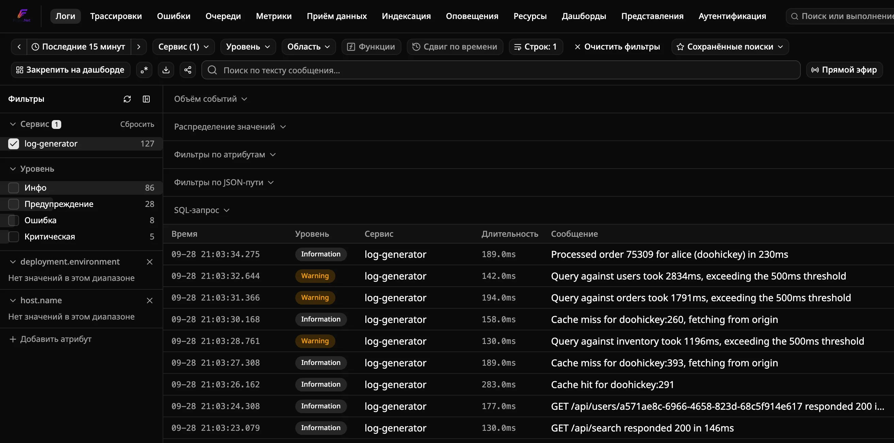
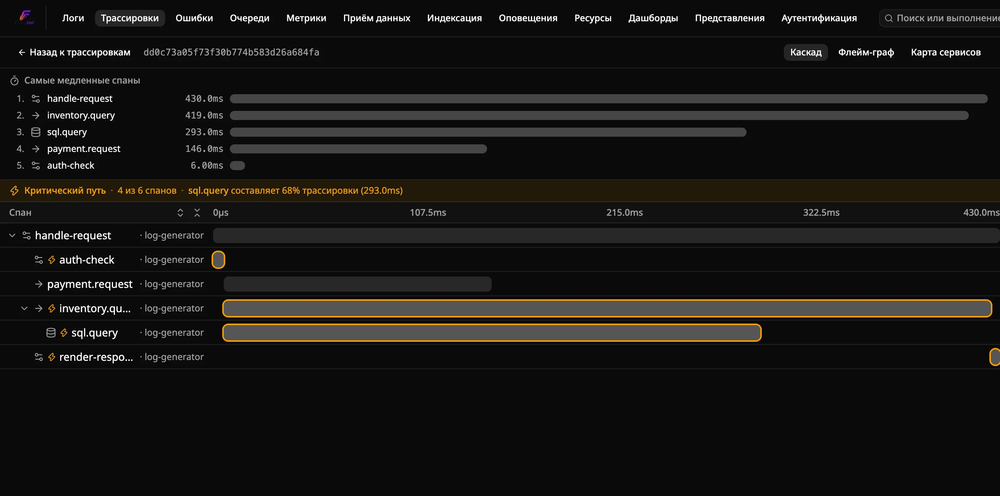
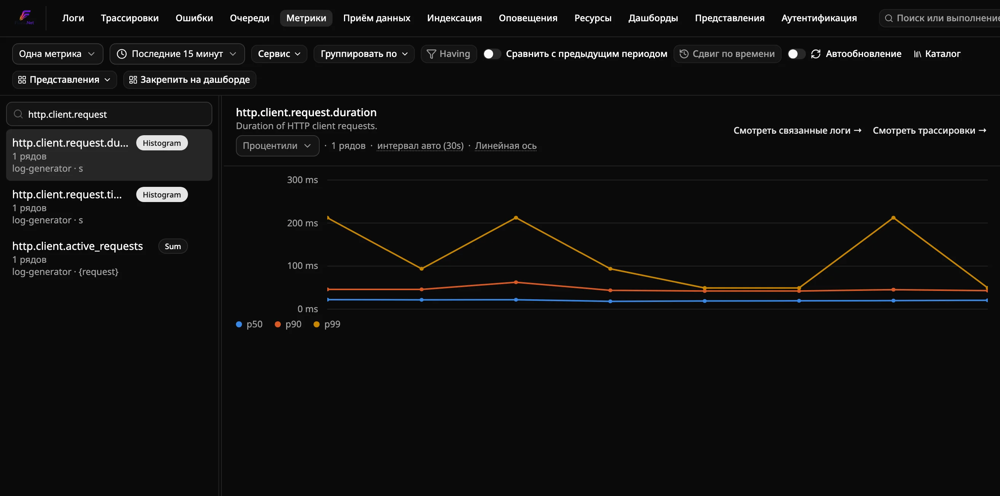
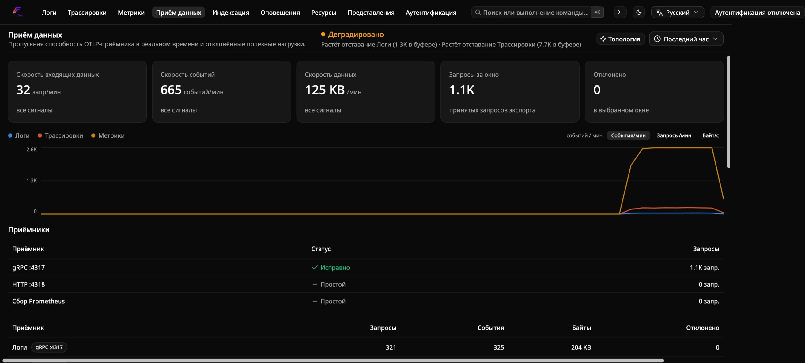
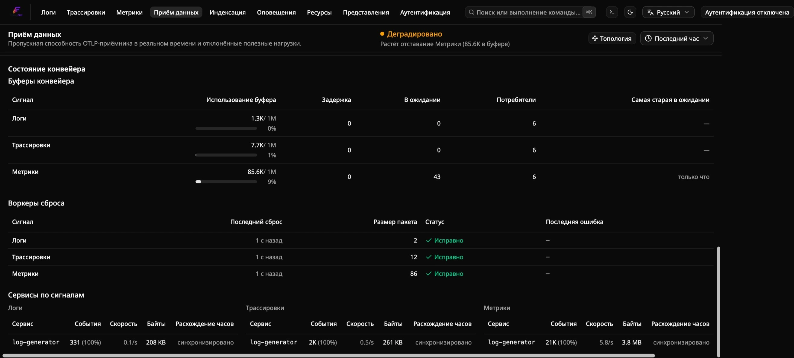
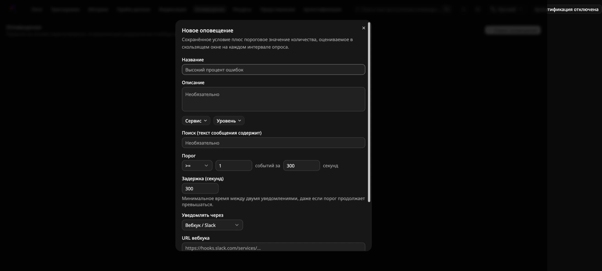
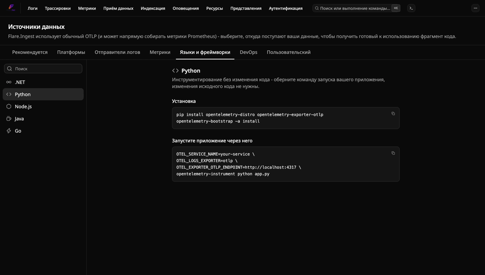
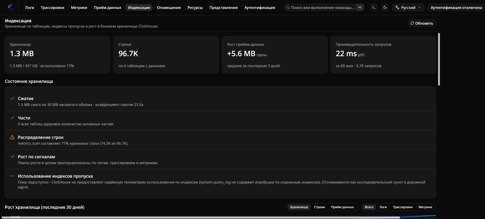
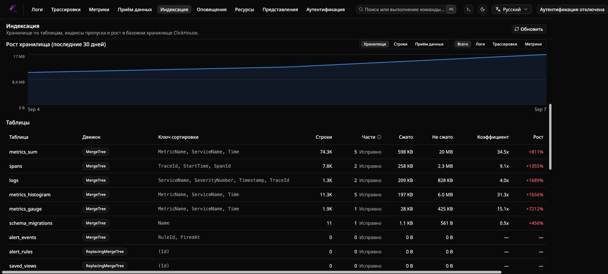
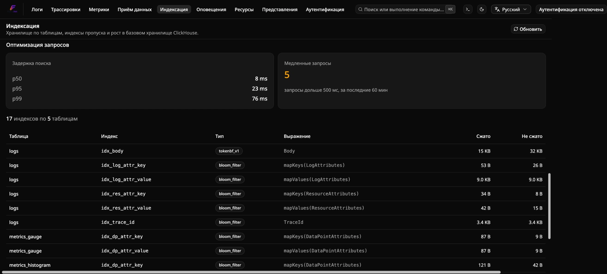

<!-- Translated (ru) from docs/explanation/architecture.md · source-sha256:398a93dfeb49de44 · hand-translated by Claude, not generated by scripts/translate-docs.py - edit the source file and retranslate if it changes, don't machine-retranslate over this. -->

# Архитектура

Flare — это самостоятельно размещаемая платформа наблюдаемости для .NET
на основе OpenTelemetry — логи, трассировки, метрики и профили как
полноценные сущности, объединённые в одном месте, с оповещениями (пороги,
аномалии, скорость расходования бюджета ошибок), отслеживанием ошибок и
дашбордами поверх них. Эта страница объясняет, почему она устроена именно
так; см. [`../reference/`](../reference/) для точных значений и
[`../how-to/`](../how-to/) для пошаговых инструкций.

## Почему существует Flare

Ландшафт самостоятельно размещаемых инструментов логирования для
разработчиков на .NET — это выбор между двумя разочарованиями: **Seq** —
надёжный движок, но устаревший интерфейс и бесплатный тариф только для
одного пользователя — и **Grafana / SigNoz / OpenObserve** — мощные и
нативно поддерживающие OTel, но тяжёлые в эксплуатации, универсальные для
OTel, а не заточенные под опыт разработчика на .NET, и созданные для
инфраструктурных/SRE-команд, а не для разработчика, который просто хочет
красиво читать телеметрию своего приложения.

Ставка Flare: **проблема хранения/запросов уже решена ClickHouse (см.
[ADR-0013](../../docs-internal/adr/0013-clickhouse-as-storage-engine.md)).
Отличие — это отличная панель управления и настройка за две минуты.**
Именно туда направлены усилия — Flare не гонится за паритетом функций с
полноценным пакетом инструментов наблюдаемости; см. [Что не входит в цели](#нецели)
ниже.

## Принципы проектирования

1. **Единственный протокол на входе: OTLP.** Никаких адаптеров приёма для
   каждой библиотеки логирования — каждый поддерживаемый логгер и каждый
   другой сигнал достигают Flare через протокол OpenTelemetry. Единственный
   другой путь на вход — приёмник опроса Prometheus (scrape) — существует
   для экспортеров, которые говорят только на Prometheus. См.
   [ADR-0012](../../docs-internal/adr/0012-otlp-only-ingestion.md).
2. **Хранение — решённая проблема.** ClickHouse служит бэкендом, хорошо
   обёрнутым, а не изобретённым заново. См.
   [ADR-0013](../../docs-internal/adr/0013-clickhouse-as-storage-engine.md).
3. **Панель управления — это продукт.** Фронтенду уделяется первоклассное
   внимание — он должен выглядеть и ощущаться не так, как Seq или панель
   Grafana. См. [ADR-0001](../../docs-internal/adr/0001-sveltekit-dashboard.md)
   про стек, лежащий в основе.
4. **Минимум затрат на пробу.** `docker compose up` для автономного пути;
   CLI `flare` для постоянно работающего экземпляра. Если попробовать
   Flare занимает больше двух минут — это баг в опыте первого запуска.
5. **DX в первую очередь для .NET, но не только для .NET.** Опыт первого
   запуска ориентирован на логгеры .NET, Aspire и .NET MAUI, но поскольку
   приём данных — это чистый OTLP, полиглотные команды не остаются за бортом.
6. **Вычислить один раз, читать много раз.** Работа, которую повторял бы
   каждый показ страницы (RED-метрики, карта сервисов, счётчики SLO,
   шаблоны логов), выполняется при вставке, а каждый запрос ограничен по
   ресурсам, чтобы один неудачный фильтр не положил базу. См.
   [Как Flare хранит телеметрию и выполняет запросы](how-flare-stores-and-queries-telemetry.ru.md).
7. **Данные остаются у вас.** Самостоятельное размещение означает, что
   телеметрия остаётся в вашей инфраструктуре, а всё, что может её
   покинуть (проверка обновлений, ИИ-провайдеры, каналы уведомлений,
   пересылка), опционально или видимо. См.
   [Расположение данных и конфиденциальность](data-residency-and-privacy.ru.md).
8. **Дисциплина в рамках объёма.** Поставляйте узкий, сфокусированный
   набор функций. Спекулятивные идеи попадают в
   [дорожную карту](../../docs-internal/planning/roadmap.md), а не в то,
   что поставляется прямо сейчас.

## Конвейер от приёма данных до панели управления

```
  ┌─────────────────────────────────────────────┐
  │  Ваши приложения / сервисы                    │
  │  Serilog · NLog · ZLogger · MS ILogger · любой│
  │  источник OTLP (Go, Node, Python, браузеры,  │
  │  .NET MAUI, OpenTelemetry Collector, ...)    │
  └───────────────────────┬─────────────────────┘
                          │  OTLP  (gRPC :4317 / HTTP :4318)
                          │  (+ опрос Prometheus, pull)
                          ▼
  ┌─────────────────────────────────────────────┐
  │  Flare.Ingest  (ASP.NET Core)                │
  │  • Приёмник OTLP (логи, трассировки, метрики,│
  │    профили)                                  │
  │  • Аутентификация по ключам приёма и лимиты  │
  │  • Нормализация → внутренняя модель событий   │
  │  • Правила маскирования/извлечения,          │
  │    семплирование трассировок                 │
  │  • Буфер (один Redis Stream на сигнал)       │
  │  • Воркеры сброса: пакетная вставка, затем ack│
  └───────────────────────┬─────────────────────┘
                          │  пакетные вставки
                          ▼
  ┌─────────────────────────────────────────────┐
  │  ClickHouse   (колоночное хранилище)         │
  │  телеметрия · предагрегаты · таблицы настроек│
  └───────────┬───────────────────────┬─────────┘
              │  SQL                  │  SQL
              ▼                       ▼
  ┌──────────────────────────┐  ┌────────────────────────┐
  │  Flare.Api               │  │  Flare.AlertWorker     │
  │  • Поиск / агрегация     │  │  • Вычисляет правила   │
  │  • Живой просмотр        │  │    оповещений          │
  │    (WebSocket)           │  │  • Отправляет          │
  │  • CRUD настроек, auth   │  │    уведомления         │
  │  • MCP, API, совместимые │  │  • Синтетические пробы,│
  │    с Prometheus/Loki/    │  │    отчёты, архив       │
  │    Tempo                 │  │                        │
  └────────────┬─────────────┘  └────────────────────────┘
               │  HTTP / WS
               ▼
  ┌─────────────────────────────────────────────┐
  │  Flare.Dashboard  (SPA)                      │
  │  • Логи, трассировки, ошибки, метрики,       │
  │    оповещения, дашборды и др.                │
  │  • Живой просмотр · сохранённые представления│
  │    · графики                                 │
  └─────────────────────────────────────────────┘
```

Три пути чтения отходят от буфера Redis или ClickHouse, и ни один из них не
замедляет приём данных: запросы идут в ClickHouse, живой просмотр читает тот
же Redis Stream, в который пишет Ingest (поэтому новые строки появляются до
сброса в ClickHouse), а вычисление оповещений работает в отдельном процессе.

| Компонент | Технология | Ответственность |
|---|---|---|
| `Flare.Ingest` | ASP.NET Core | Принимает OTLP (gRPC + HTTP) для логов, трассировок, метрик и профилей, а также конечные точки скриншотов и отзывов, которые использует `Flare.Maui`. Проверяет ключи приёма и применяет их лимиты, преобразует во внутреннюю модель событий, применяет [правила конвейера](../how-to/data/manage-pipeline-rules.ru.md), кластеризацию шаблонов логов и семплирование трассировок, буферизует, пакетно вставляет в ClickHouse. Также опрашивает конечные точки Prometheus и может пересылать телеметрию на другую конечную точку OTLP |
| Redis | контейнер | Устойчивый буфер между приёмом данных и ClickHouse — см. [ADR-0002](../../docs-internal/adr/0002-redis-streams-buffering.md). Также кэш результатов запросов ([ADR-0029](../../docs-internal/adr/0029-query-result-caching.md)) и блокировка с маркерами, благодаря которым вычисление оповещений идёт на одной реплике за цикл |
| ClickHouse | контейнер | Хранение логов/трассировок/метрик/профилей и движок запросов, предагрегированные таблицы, которые читают страницы Services и SLO, и таблицы настроек (правила оповещений и их история, дашборды, сохранённые представления, SLO, страницы статуса) — см. [ADR-0013](../../docs-internal/adr/0013-clickhouse-as-storage-engine.md) |
| `Flare.Api` | ASP.NET Core | Запросы/поиск/агрегация по ClickHouse; конечная точка потоковой передачи живого просмотра; CRUD для всего настраиваемого; конечные точки аутентификации; конечная точка [MCP](../how-to/integrations/connect-ai-assistants.ru.md) только для чтения и API запросов, совместимые с Prometheus, Loki и Tempo |
| `Flare.AlertWorker` | воркер ASP.NET Core | Вычисляет правила оповещений и отправляет уведомления, запускает синтетические пробы и (если включено) формирует отчёты по дашбордам по расписанию и архивирует телеметрию в S3-совместимое хранилище. Выделен из `Flare.Api`, чтобы развёртывание API не приостанавливало оповещения — см. [ADR-0018](../../docs-internal/adr/0018-alert-worker-extraction.md) |
| `Flare.Identity` | библиотека | Пользователи, сессии, персональные токены доступа, ключи приёма, проекты, журнал аудита и source maps. Подключена и к `Flare.Ingest`, и к `Flare.Api`, хранится по умолчанию во встроенном файле SQLite или в Postgres — см. [ADR-0004](../../docs-internal/adr/0004-embedded-sqlite-for-identity.md) и [ADR-0111](../../docs-internal/adr/0111-pluggable-identity-store-postgres.md) |
| `Flare.Dashboard` | SvelteKit (Svelte 5, runes) + Tailwind + shadcn-svelte | Интерфейс — то, ради чего сюда приходят. См. [ADR-0001](../../docs-internal/adr/0001-sveltekit-dashboard.md). |
| `Flare.AppHost` | .NET Aspire | Локальная оркестрация всего вышеперечисленного |
| `Flare.Cli`, `Flare.Mcp` | глобальный инструмент .NET | CLI `flare`, который управляет постоянно работающим экземпляром и опрашивает его из терминала; `flare mcp` — те же инструменты только для чтения по stdio |
| `Flare.Maui` | пакет NuGet | `UseFlare()` для приложений .NET MAUI: сессии, сбои, зависания, производительность запуска, хлебные крошки — см. [ADR-0166](../../docs-internal/adr/0166-maui-sdk.md) |

Flare по-прежнему состоит из четырёх запускаемых частей (Ingest, Api,
AlertWorker, Dashboard) и двух хранилищ (ClickHouse, Redis); Identity
добавляет к ним файл SQLite, а не пятый контейнер. Необязательное объектное
хранилище (RustFS в поставляемых конфигурациях Compose и Aspire) обслуживает
[холодный уровень](retention-and-tiering.ru.md) и архив, а необязательный
прокси сокета Docker только для чтения питает страницу Resources.

Каждый OTLP-совместимый логгер .NET достигает приёмника Flare одинаковым
способом — см. [`../how-to/deploy/run-standalone.md`](../how-to/deploy/run-standalone.ru.md)
для готового фрагмента кода по каждому логгеру
(`Microsoft.Extensions.Logging`/ZLogger через `OpenTelemetry.Exporter.OpenTelemetryProtocol`,
Serilog через `Serilog.Sinks.OpenTelemetry`, NLog через
`NLog.Targets.OpenTelemetryProtocol`) и
[`../reference/otlp-logger-versions.md`](../reference/otlp-logger-versions.ru.md)
для проверенных версий пакетов.

### Где почитать подробнее

| Вопрос | Страница |
|---|---|
| Что происходит с данными, когда Ingest перезапускается или ClickHouse недоступен? | [Надёжность приёма и гарантии доставки](ingest-reliability-and-delivery-guarantees.ru.md) |
| Почему ClickHouse, как устроены таблицы, что ограничивает запросы? | [Как Flare хранит телеметрию и выполняет запросы](how-flare-stores-and-queries-telemetry.ru.md) |
| Как правило проходит путь от нарушения до уведомления и восстановления? | [Как работают оповещения](how-alerting-works.ru.md) |
| Чего стоят семплирование, кластеризация шаблонов и кардинальность? | [Семплирование, кластеризация и стоимость](sampling-clustering-and-cost.ru.md) |
| Как долго хранятся данные и что такое холодный уровень? | [Хранение и уровни](retention-and-tiering.ru.md) |
| Как работают вход, токены и ключи приёма? | [Модель аутентификации](authentication-model.ru.md) |
| Как ограничить команду её собственными сервисами? | [Проекты и разграничение доступа](projects-and-access-scoping.ru.md) |
| Как запустить больше одного узла ClickHouse? | [Кластеризация](clustering.ru.md) |
| Куда попадают мои данные и что может покинуть машину? | [Расположение данных и конфиденциальность](data-residency-and-privacy.ru.md) |

## Нецели

- Не агент APM. Flare не инструментирует ваш код и не поставляет агента; он
  принимает то, что отправляет OpenTelemetry. Он делает распределённую
  трассировку, непрерывное профилирование (сигнал OTLP profiles, который в
  OpenTelemetry ещё в Alpha) и отслеживание релизов по отправляемым вами
  данным.
- Не SIEM. Есть журнал аудита и маскирование при приёме, но нет
  аналитики безопасности и правил корреляции.
- Не замена Sentry или GlitchTip для всех платформ. Отслеживание ошибок
  строится из исключений OTel, сгруппированных на [странице Errors](#ошибки),
  с символизацией для .NET и source maps для JavaScript, а `Flare.Maui` и
  [запись сессий в браузере](../how-to/instrument/send-browser-telemetry.ru.md#запись-сессии-session-replay) —
  выделенные клиентские SDK; остальные платформы отправляют OTLP.
- Не готовая замена Prometheus, Loki или Tempo. Совместимые API доступны
  только для чтения и покрывают подмножество PromQL, LogQL и TraceQL —
  достаточно, чтобы Grafana запрашивала Flare, но не чтобы заменить эти
  серверы.
- Не гонится за паритетом функций с Datadog/Grafana/SigNoz. Другая
  ставка — см. [Почему существует Flare](#почему-существует-flare) выше.

## Построен на

.NET/ASP.NET Core, .NET Aspire, ClickHouse, Redis, OpenTelemetry/OTLP,
SvelteKit (Svelte 5) + Tailwind + shadcn-svelte, SQLite или Postgres для
идентификации, Docker Compose и Helm. Необязательные части: RustFS
(S3-совместимый) для холодного уровня и архива и Chromium (через
Playwright) для отправляемых по почте отчётов по дашбордам. Плагин
источника данных Grafana написан на TypeScript с бэкендом на Go.

## Способы запустить Flare и почему существует каждый из них

У Flare есть три законных локальных пути установки, каждый решает свою
задачу, а не дублирует остальные, и четвёртый — для производственных
кластеров:

- **[.NET Aspire](../how-to/deploy/run-with-aspire.ru.md)** (`Flare.Hosting.Aspire`) —
  для приложения, у которого уже есть AppHost. Flare присоединяется к
  графу ресурсов; `aspire start` уже оркестрирует его жизненный цикл
  наряду со всем остальным.
- **[Автономный Docker Compose](../how-to/deploy/run-standalone.ru.md)** — для
  разовой, локальной для репозитория оценки. `docker compose up` в корне
  репозитория — самый быстрый способ просто взглянуть на Flare один раз.
- **[CLI `flare`](../how-to/deploy/run-with-cli.ru.md)** (`Flare.Cli`, из
  NuGet или npm) — для постоянно работающего экземпляра, который вы
  запускаете один раз и забываете о нём, из любого каталога, общего для
  нескольких независимых локальных проектов, независимо от жизненного цикла
  какого-либо отдельного AppHost. Это тот случай, который два других пути
  структурно не могут покрыть: режим Aspire привязывает жизненный цикл
  Flare к одному AppHost, а локальный для репозитория стек Compose не
  предназначен для работы неделями в фоновом режиме, обслуживая
  несвязанные проекты.
- **[Kubernetes с Helm](../how-to/deploy/deploy-with-helm.ru.md)** — для
  общей или производственной установки: весь стек из одного чарта, с
  Ingress и сгенерированными паролями. Для более чем одного узла ClickHouse
  см. [кластерный режим](../how-to/deploy/run-cluster-mode.ru.md) и
  [Кластеризацию](clustering.ru.md).

## Обзор панели управления

Какой бы путь установки вы ни выбрали, вы попадёте в одно и то же место:
`Flare.Dashboard` — единое SvelteKit SPA-приложение, которое общается с
`Flare.Api` по HTTP/WebSocket, без отдельных инструментов для логов,
трассировок, метрик, ошибок или оповещений. При первом визите создаётся
учётная запись администратора (см.
[`../how-to/admin/configure-authentication.md`](../how-to/admin/configure-authentication.ru.md));
после этого — обычный вход.

В панели навигации — самые используемые страницы (Logs, Traces, Errors,
Messaging, Metrics, Ingestion, Alerts, Resources, Dashboards, Views и Auth
для администраторов); Releases, Frontend, External APIs, Sessions, LLM,
Profiles, Hosts и Kubernetes находятся в меню «ещё». Настройки находятся в
разделе **Settings**, описанном [в конце обзора](#настройки). `Ctrl+K`
(`⌘K` на macOS) открывает палитру команд, которая позволяет перейти к любой
из них.

### Логи

Вид по умолчанию (`/`). Плотная, виртуализированная таблица логов с живым
просмотром (потоковая передача в реальном времени, пауза/возобновление),
графиком объёма событий и фильтрами по сервису, уровню, области видимости,
атрибутам и полнотекстовому поиску по телу сообщения. Кликните по любой
строке, чтобы развернуть её полную структурированную полезную нагрузку,
области видимости и детали исключения.



### Трассировки

`/traces` — каждая OTLP-трассировка, полученная Flare, с фильтрацией по
сервису и временному диапазону. Автоматически инструментированные спаны
(ASP.NET Core, HttpClient, …) и всё, что излучает ваш собственный код
через `ActivitySource`, отображаются рядом друг с другом. По умолчанию
список отсортирован от новых к старым; щёлкните заголовок столбца «Время»,
«Длительность» или «Спаны», чтобы отсортировать по нему (повторный щелчок
меняет направление), — например, самые медленные запросы за период или
трассировки с наибольшим числом спанов.


Кликните по трассировке, чтобы открыть каскадный вид (waterfall) —
родительские/дочерние спаны, расположенные по времени начала и
длительности, та же форма, что у Jaeger/Zipkin, но встроенная прямо в
остальную часть панели управления. События спана отображаются точками
на его полосе в момент, когда они произошли (исключения — красным);
наведите курсор на точку, чтобы увидеть её имя, смещение и ключевые
атрибуты. Вкладка «Флейм-граф» показывает те же спаны в виде флейм-графа
(ширина = длительность, уровни по глубине, цвет по сервису), чтобы сразу
увидеть, куда ушло время в большой трассировке; щелчок по спану открывает
подробности, двойной щелчок — масштабирует до него. В обоих видах поле
«Поиск спанов» находит спаны по имени, сервису, id спана или атрибуту
(работает и `ключ=значение`): совпадения подсвечиваются, остальное
приглушается, а Enter / Shift+Enter переходят между ними, раскрывая по
пути свёрнутых родителей.



Вкладка «Services» рядом со списком трассировок даёт сортируемую сводку по
каждому сервису для RED-метрик (частота запросов, доля ошибок, задержка
p50/p95/p99), вычисляемых из тех же спанов, за собственное выбираемое окно
(от 5 минут до 24 часов), с обновлением каждые 10 секунд. Она отвечает на
вопрос «какой сервис сейчас нездоров», и не нужно вручную собирать
эквивалентный запрос в поиске трассировок или в выборе метрик. Под
«запросами» здесь понимаются корневые спаны (`ParentSpanId` пуст) — точки
входа трассировок сервиса, та же договорённость, что и в самом списке
трассировок: «одна строка на трассировку». Щёлкните по имени сервиса, чтобы
вернуться к списку трассировок, предварительно отфильтрованному по этому
сервису и окну. Сводка читает таблицу, заполняемую при вставке, а не
сканирует спаны при каждом обновлении
([ADR-0030](../../docs-internal/adr/0030-service-red-metrics-pre-aggregation.md)),
и та же идея лежит в основе карты зависимостей сервисов и разбивки вызовов
([ADR-0031](../../docs-internal/adr/0031-service-map-breakdown-pre-aggregation.md)).

Вкладка «Воронки» (`/traces/funnels`) проводит трассировки через
упорядоченный список шагов, каждый из которых задаётся условием на span
(сервис, имя span, фильтры по атрибутам). Она показывает, сколько трассировок
дошло до каждого шага, где они отсеялись, ошибки на каждом шаге и задержку
между шагами. Каждое число открывает соответствующие трассировки. Всё
вычисляется при запросе по сохранённым span, а воронки сохраняются как
обычные сохранённые представления. См.
[`../how-to/investigate/analyze-trace-funnels.ru.md`](../how-to/investigate/analyze-trace-funnels.ru.md)
и [ADR-0067](../../docs-internal/adr/0067-trace-funnels.md).

Кнопка «Структура» на панели инструментов списка трассировок фильтрует по
связям между спанами трассировки: условия с буквами объединяются операторами
`A -> B` (прямой потомок), `A => B` (потомок на любой глубине), AND, OR и
NOT — например, «спан `checkout` с потомком `payment`, завершившимся
ошибкой». Это поле `SpanFilter`, которое вычисляется во время запроса как
подзапрос по `TraceId`, поэтому его учитывают список, фасеты, сохранённые
представления и панели дашбордов. См.
[`../how-to/investigate/find-traces-by-structure.ru.md`](../how-to/investigate/find-traces-by-structure.ru.md)
и [ADR-0069](../../docs-internal/adr/0069-structural-trace-queries.md).

Ещё два вида читают те же спаны. Вид «N+1» перечисляет трассировки, в
которых один родительский спан выполнил 10 или больше одинаковых запросов к
базе данных (см.
[`../how-to/investigate/find-n-plus-one-queries.ru.md`](../how-to/investigate/find-n-plus-one-queries.ru.md)),
а в сведениях о спане можно увидеть, была ли его длительность большой *для
спана такого вида* (см.
[`../how-to/investigate/compare-span-duration.ru.md`](../how-to/investigate/compare-span-duration.ru.md)).

### Ошибки

`/errors` — исключения, сгруппированные по типу и нормализованному сообщению (идентификаторы, числа и значения в кавычках сворачиваются), со
счётчиками, сервисами и версиями, где они встречаются, и примером стека
вызовов. У каждой группы есть жизненный цикл: пометить её решённой или
игнорируемой, назначить кому-то, привязать к задаче в вашем трекере — и
Flare сообщит, когда «исправленная» ошибка вернётся (регрессия). Правила
владения (по сервису, типу исключения или пути к файлу исходников)
назначают группу нужному человеку, а кадры стека могут ссылаться на точную
строку в вашем репозитории или показывать исходный код прямо в интерфейсе.
Список строится из событий `exception`, записанных в спанах, поэтому
работает с любым отправителем OTLP, который записывает исключения в свои
спаны. См.
[`../how-to/investigate/triage-errors.ru.md`](../how-to/investigate/triage-errors.ru.md),
[`../how-to/investigate/link-exceptions-to-source-code.ru.md`](../how-to/investigate/link-exceptions-to-source-code.ru.md)
и [ADR-0121](../../docs-internal/adr/0121-error-issue-lifecycle.md).

### Релизы

`/releases` — отметьте, что версия сервиса была выпущена (из вашего
конвейера, с персональным токеном доступа), и Flare перечислит по каждой
версии группы исключений, впервые появившиеся в ней, с маркерами релизов на
графиках и оповещениями, когда релиз вносит ошибки. Чтобы сравнить две
версии сервиса бок о бок (задержка, ошибки, пропускная способность, новые
исключения и новые исходящие зависимости), откройте сервис на вкладке
Services страницы Traces. См.
[`../how-to/investigate/track-releases.ru.md`](../how-to/investigate/track-releases.ru.md),
[`../how-to/investigate/compare-deploys.ru.md`](../how-to/investigate/compare-deploys.ru.md)
и [ADR-0182](../../docs-internal/adr/0182-release-tracking.md).

### Frontend

`/frontend` — то, что браузерные приложения сообщают через JavaScript SDK
OpenTelemetry: загрузки страниц, смены маршрутов, Core Web Vitals и
JavaScript-ошибки, причём минифицированные стеки вызовов сопоставляются с
исходным кодом по загруженным source maps. Спаны браузера разделяют
идентификатор трассировки с вашим бэкендом, поэтому медленный клик можно
проследить до вызова API и его запросов. Браузеры отправляют данные в
приёмник OTLP/HTTP, так что ключ приёма можно ограничить источниками,
которым разрешено его использовать. См.
[`../how-to/instrument/send-browser-telemetry.ru.md`](../how-to/instrument/send-browser-telemetry.ru.md)
и [ADR-0153](../../docs-internal/adr/0153-frontend-page-and-source-map-settings.md).

### Сессии

`/sessions` — по строке на каждую сессию приложения от `Flare.Maui`:
устройство, ОС и версия приложения, закончилась ли она сбоем или зависанием,
хронология сессии с экранами, хлебными крошками, сетевыми вызовами и
ошибками, необязательные скриншоты и отзывы пользователей, а также
производительность запуска и загрузки экранов. На странице также показано
здоровье релизов: доля сессий и пользователей без сбоев по версиям
приложения ([ADR-0175](../../docs-internal/adr/0175-release-health.md)). См.
[`../how-to/instrument/send-maui-telemetry.ru.md`](../how-to/instrument/send-maui-telemetry.ru.md),
[`../tutorials/monitor-a-maui-app.ru.md`](../tutorials/monitor-a-maui-app.ru.md) и
[ADR-0167](../../docs-internal/adr/0167-app-sessions-view.md).

### Очереди сообщений

`/messaging` — по строке на каждый топик Kafka, очередь RabbitMQ, тему NATS
или сущность Service Bus (включая типы сообщений MassTransit): скорость
публикации и потребления, доля ошибок, задержка p99 и объём ожидающих
сообщений — как отставание потребителей Kafka, глубина очередей RabbitMQ,
число ожидающих сообщений NATS JetStream, активные сообщения Service Bus или
видимые сообщения SQS. Скорости и задержки вычисляются во время запроса
из атрибутов OTel `messaging.*` спанов производителей и потребителей,
поэтому отдельный агент или таблица не нужны; объём ожидающих сообщений
берётся из метрик, которые ваш брокер или коллектор уже экспортирует
(например, из ресивера `kafkametrics` или `rabbitmq`), если они есть.
Нажмите на строку, чтобы увидеть производителей, потребителей,
партиции, отставание по группам или глубину по очередям. См. [`../how-to/monitor/monitor-message-queues.ru.md`](../how-to/monitor/monitor-message-queues.ru.md),
[ADR-0056](../../docs-internal/adr/0056-messaging-queue-monitoring.md) и
[ADR-0057](../../docs-internal/adr/0057-rabbitmq-queue-depth.md).

### Внешние API

`/external-apis` — по строке на каждый внешний домен, который вызывают
ваши сервисы: частота, доля ошибок, задержка p95/p99, число эндпоинтов и
время последнего вызова. Всё вычисляется во время запроса из
`server.address` спанов `CLIENT` (иначе `net.peer.name`, иначе хост из
URL), без вызовов баз данных и брокеров сообщений. Нажмите на домен, чтобы
увидеть его эндпоинты (метод плюс `url.template` или путь URL, где
сегменты-идентификаторы заменены на `{id}`), коды ответа, частые ошибки и
вызывающие сервисы - со ссылками на соответствующие трейсы. Вкладка
External calls в разбивке сервиса использует тот же домен, если у span
нет `peer.service`. Карта сервисов добавляет листовой узел для каждого
хоста, до которого дошли исходящие вызовы без инструментированного дочернего
спана; он читается из таблицы `outbound_calls` (миграция 0035) через
анти-соединение с идентификаторами родительских спанов. См. [`../how-to/monitor/monitor-external-apis.ru.md`](../how-to/monitor/monitor-external-apis.ru.md),
[ADR-0071](../../docs-internal/adr/0071-external-api-monitoring.md) и
[ADR-0072](../../docs-internal/adr/0072-external-host-map-leaves.md).

### LLM

`/llm` — как ваши сервисы используют языковые модели, по спанам, которые
следуют соглашениям GenAI OpenTelemetry: по каждому провайдеру и модели —
частота вызовов, доля ошибок, задержка и входные и выходные токены, с
оценкой стоимости по таблице цен и переходом в один клик к соответствующим
трассировкам. Предагрегированная таблица обеспечивает быстрый отклик. См.
[`../how-to/monitor/monitor-llm-calls.ru.md`](../how-to/monitor/monitor-llm-calls.ru.md),
[ADR-0100](../../docs-internal/adr/0100-llm-observability-genai-spans.md) и
[ADR-0101](../../docs-internal/adr/0101-llm-estimated-cost.md).

### Профили

`/profiles` — непрерывное профилирование: флейм-графы того, куда уходит
время ЦП или память, по сигналу OTLP profiles на тех же портах, что и
остальные сигналы. OTLP profiles в OpenTelemetry находится в Alpha, и пока
мало отправителей его выдаёт, поэтому считайте эту страницу ранней. См.
[`../how-to/investigate/profile-with-continuous-profiling.ru.md`](../how-to/investigate/profile-with-continuous-profiling.ru.md)
и [ADR-0141](../../docs-internal/adr/0141-continuous-profiling-ingest.md).

### Метрики

`/metrics` — каждый OTLP-инструмент метрик (Sum, Gauge, Histogram, экспоненциальная Histogram),
передаваемый вашими сервисами, доступный для просмотра в боковой панели с
поиском и отображаемый как график временного ряда для каждого
инструмента. Охватывает как бесплатные данные
`AddAspNetCoreInstrumentation()`/`AddRuntimeInstrumentation()` (GC .NET,
пул потоков, Kestrel, HTTP-клиент/сервер), так и всё, что излучает ваш
собственный `Meter`. Графики поддерживают группировку, формулы между
запросами, функции вроде скорости изменения, сглаживания и сдвига по
времени, а также точки-экземпляры (exemplars), связывающие точку графика с
трассировкой. Счётчики показываются как скорость или прирост с учётом
сбросов. Вид Catalog (`/metrics/catalog`) перечисляет каждую метрику с её
типом, единицей, описанием и числом рядов, позволяет переопределить единицу
или описание и помогает находить метрики с высокой кардинальностью. Цели
опроса Prometheus и метрики на основе логов попадают в те же таблицы, так
что они строятся и порождают оповещения так же. Чтение тех же данных из
Grafana описано в разделе [Интеграции](#интеграции-и-api).



### Дашборды

`/dashboards` — ваши собственные доски с панелями. Панель — это график по
логам, трассировкам или метрикам (временной ряд, столбцы, значение, круговая
диаграмма, таблица, гистограмма и тепловая карта), формула над запросами
метрик или текст. У досок есть переменные (с несколькими значениями и
цепочками, где одна берёт значения из другой), сворачиваемые строки, теги,
выбор домашнего дашборда, пороговые значения для панелей и владелец, так что
доску одного человека не изменит втихую другой. Доску можно дублировать,
экспортировать в JSON, экспортировать в JSON Grafana, начать со встроенного
шаблона и отправлять по почте по расписанию. Щелчок по панели открывает тот
же запрос в обозревателе Logs, Traces или Metrics. См.
[`../how-to/dashboards/build-custom-dashboards.ru.md`](../how-to/dashboards/build-custom-dashboards.ru.md),
[`../how-to/dashboards/schedule-dashboard-reports.ru.md`](../how-to/dashboards/schedule-dashboard-reports.ru.md),
[`../tutorials/first-dashboard.ru.md`](../tutorials/first-dashboard.ru.md) и
[ADR-0023](../../docs-internal/adr/0023-custom-dashboards.md).

### Resources, Hosts и Kubernetes

Три страницы об инфраструктуре под вашими сервисами; они отвечают на разные
вопросы:

- **Resources** (`/resources`) — то, что Flare обнаруживает сам: собственные
  контейнеры Docker или поды Kubernetes и машина, на которой он работает. В
  Docker Compose нужен необязательный прокси сокета Docker только для
  чтения, выключенный, пока вы его не включите
  ([ADR-0005](../../docs-internal/adr/0005-docker-socket-proxy-for-resources-page.md));
  в Kubernetes он читает поды и сервисы через RBAC, ограниченный этими
  двумя ресурсами
  ([ADR-0006](../../docs-internal/adr/0006-kubernetes-resource-graph-rbac-scoping.md)).
- **Hosts** (`/hosts`) — по строке на каждую машину, которая сообщает свои
  `hostmetrics`: ЦП, память, диск и нагрузка, с подробным графиком по каждой
  метрике. См. [`../how-to/monitor/monitor-hosts.ru.md`](../how-to/monitor/monitor-hosts.ru.md).
- **Kubernetes** (`/kubernetes`) — ваш кластер в том виде, как его сообщают
  ресиверы `kubeletstats` и `k8s_cluster` коллектора, на вкладках Nodes,
  Namespaces, Workloads, Pods и Volumes, со ссылкой с пода на его логи. См.
  [`../how-to/monitor/monitor-kubernetes.ru.md`](../how-to/monitor/monitor-kubernetes.ru.md).

### Приём данных

`/ingestion` — операционная видимость самого приёмника OTLP: текущие
показатели поступления/приёма данных, разбивка запросов, событий и байтов
по каждому сигналу (логи/трассировки/метрики) × по каждому протоколу
(gRPC/HTTP), а также журнал приёма данных со всем, что Flare отклонил
(некорректные полезные нагрузки, неподдерживаемые типы данных) и почему.
Это первая страница, которую стоит проверить, если «мои логи не
отображаются».





### Оповещения

`/alerts` — правила оповещений по тем же фильтрам и запросам, что используют
обозреватели: всё, что можно искать, можно сделать оповещением. Условие
правила — одно из следующих:

- **число логов** (сохранённый фильтр логов плюс порог количества на
  скользящем окне);
- **порог метрики** (запрос метрики, сравниваемый со значением, с
  Last/Min/Max для gauge и приростом с учётом сбросов для счётчиков);
- **число исключений**;
- **аномалия**, оцениваемая относительно того же окна в предыдущие дни или
  недели
  ([ADR-0048](../../docs-internal/adr/0048-anomaly-detection-alerting.md));
- **скорость расходования бюджета ошибок SLO**, срабатывающая, когда бюджет
  ошибок SLO сгорает слишком быстро и в длинном, и в коротком окне
  ([`../how-to/alerting/define-slos.ru.md`](../how-to/alerting/define-slos.ru.md),
  [ADR-0108](../../docs-internal/adr/0108-slo-error-budgets.md));
- **ошибки релиза**, когда релиз вносит новые группы исключений, и **доля
  сессий без сбоев** для мобильных версий.

У каждого правила есть период остывания и пробный запуск «проверить на
текущих данных» перед сохранением. По умолчанию каждое правило проверяется
на каждом цикле опроса воркера оповещений (30 с), а для медленных и дорогих
правил можно задать собственный интервал «Evaluate every» (от 1 мин до 1 ч).
Правила могут также:

- требовать минимальное число точек данных в окне метрического правила;
  если их меньше, оно сообщает о недостатке данных и не срабатывает;
- оповещать об отсутствии данных, когда условию не соответствует ничего;
- задавать порог восстановления (например, срабатывать при 90 %,
  восстанавливаться ниже 80 %), чтобы значение, колеблющееся около порога,
  не переключалось постоянно между сработавшим и закрытым состоянием;
- иметь важность (critical, error, warning или info; по умолчанию
  critical): она передаётся как severity в PagerDuty, отображается в
  уведомлениях других каналов и доступна шаблонам как `{{severity}}`;
- задавать порог в другой единице, чем у метрики (`500 ms` для метрики в
  секундах); перед каждым сравнением он пересчитывается (см.
  [ADR-0080](../../docs-internal/adr/0080-alert-threshold-unit.md));
- нести собственные метки ключ/значение (`team=payments`): по ним
  фильтруется список правил, они доступны как `{{labels.team}}` и в
  webhook-запросах (см.
  [ADR-0084](../../docs-internal/adr/0084-alert-rule-labels.md)).

Правило может заменить заголовок и текст своего уведомления шаблоном с
подстановками вроде `{{value}}`, `{{threshold}}`, `{{logs_url}}`,
`{{log_samples}}` (самые новые подходящие строки логов в оповещении по числу
логов) или `{{labels.service.name}}`, с живым предпросмотром в форме
правила. Шаблоны можно использовать совместно в нескольких правилах через
Settings > Workspace > Alert templates. Если настроен публичный URL, каждое
уведомление содержит ссылку на данные, вызвавшие срабатывание: подходящие
логи, график метрики или подходящие исключения, ограниченные фильтром
правила за оценённое окно (`{{data_url}}` в шаблоне), и может содержать
подписанную ссылку подтверждения (`{{ack_url}}`).

Что происходит после срабатывания правила:

- **Уведомление.** Правило уведомляет один или несколько каналов
  уведомлений, управляемых в Settings > Workspace > Channels (или
  создаваемых прямо из формы правила кнопкой «New channel»): многоразовые
  именованные адресаты, на которые правило ссылается по ID вместо
  встраивания напрямую, так что один и тот же канал можно переиспользовать
  между правилами, а одно правило может уведомлять сразу несколько адресатов
  при одном и том же нарушении (см.
  [ADR-0021](../../docs-internal/adr/0021-reusable-notification-channels.md)).
  Типы каналов: webhook/Slack, Telegram, email, PagerDuty, Microsoft Teams,
  Discord, Jira, incident.io и Jira Service Management Ops. Правило,
  созданное до появления каналов, по-прежнему уведомляет через собственный
  встроенный канал без изменений. См.
  [`../../src/Flare.Api/README.md`](../../src/Flare.Api/README.md#alerting)
  о том, что нужно настроить на стороне сервера для каждого типа канала.
- **Подтверждение или откладывание.** Сработавшее правило можно подтвердить
  или отложить из панели управления, из CLI или прямо из уведомления, после
  чего повторы приглушаются; неподтверждённые оповещения могут
  эскалироваться через дальнейшие шаги и графики дежурств (см.
  [`../how-to/alerting/acknowledge-and-snooze-alerts.ru.md`](../how-to/alerting/acknowledge-and-snooze-alerts.ru.md)
  и [ADR-0124](../../docs-internal/adr/0124-alert-acknowledgement-and-snooze.md)).
- **Восстановление.** Когда сработавшее правило возвращается в норму, его
  каналы получают уведомление «Resolved», а инциденты PagerDuty закрываются
  автоматически. Каждый канал может отказаться от таких уведомлений
  переключателем «Отправлять уведомления о восстановлении». История правила
  записывает восстановление рядом со срабатыванием (см.
  [ADR-0064](../../docs-internal/adr/0064-alert-resolved-notifications.md)).
- **Заглушение.** В каждой строке правила есть действие «Заглушить» (от 15
  минут до недели или до даты, с необязательной причиной): оно создаёт
  разовое окно для этого правила; строка показывает «Заглушено до …», а
  кнопка «Включить» завершает окно досрочно. Settings > Workspace >
  Maintenance windows планирует разовые, ежедневные или еженедельные окна (в
  выбранном часовом поясе) для всех правил, выбранных правил или правил с
  определённой меткой, поэтому новые правила охватываются автоматически. Во
  время окна правила по-прежнему вычисляются, но срабатывание записывается в
  историю правила как подавленное вместо уведомления (см.
  [ADR-0055](../../docs-internal/adr/0055-alert-maintenance-windows.md)).
- **Сводка.** Если настроен ИИ-провайдер, сработавшее оповещение может
  получить краткое описание простым языком (см.
  [`../how-to/alerting/summarize-alerts-with-ai.ru.md`](../how-to/alerting/summarize-alerts-with-ai.ru.md)).

Правила оповещений можно экспортировать и импортировать в JSON (или с
помощью `flare alerts export` / `import`), чтобы хранить их в git. О модели,
лежащей в основе всего этого, см. [Как работают оповещения](how-alerting-works.ru.md).




### Представления

`/views` — именованные, перезагружаемые фильтры, сохранённые из элемента
управления «Views» на панели инструментов Logs, Traces или Metrics.
Сохраните фильтр один раз (например, «Предупреждения с упоминанием
timeout») и загружайте его отсюда или из выпадающего списка Views этой
же страницы — доступен по ссылке, не привязан к тому, кто его создал. Каждый
обозреватель также открывается на последнем использованном вами
представлении.


### Страницы статуса

Страница статуса (`/status/<slug>`) — это страница состояния сервисов только
для чтения, которую может открыть любой, у кого есть ссылка, без учётной
записи: текущее состояние и ежедневная доступность каждого компонента,
опубликованные инциденты и необязательные подписки по почте, с вашим
оформлением и доменом. Компонент — это
[синтетический монитор](../how-to/monitor/synthetic-monitoring.ru.md) (проба
HTTP, TCP, сертификата TLS, DNS, UDP или ICMP, которую воркер оповещений
запускает по расписанию из одного или нескольких мест) либо
[SLO](../how-to/alerting/define-slos.ru.md), показываемые под выбранным вами
публичным названием. Страницы настраиваются в Settings > Workspace. См.
[`../how-to/monitor/publish-a-status-page.ru.md`](../how-to/monitor/publish-a-status-page.ru.md)
и [ADR-0158](../../docs-internal/adr/0158-status-pages.md).

### Источники данных

Доступна из выпадающего меню навигации или с пустого экрана страницы
Logs («Посмотреть, как отправлять данные») — как раз в тот момент, когда
она действительно нужна. Это каталог с возможностью поиска и готовыми
для копирования фрагментами настройки OTLP, организованный по платформам
(Kubernetes, Docker, Linux, Windows), языкам/SDK (.NET, Python, Node.js,
Java, Go), инструментам пересылки логов (Vector, Fluent Bit, Syslog),
CI/DevOps-инструментам (Jenkins, Ansible, Terraform, GitHub Actions) и
запасному варианту в виде «сырого» HTTP/JSON — плюс один пункт Prometheus
в разделе Metrics для нативного приёмника опроса (scrape) `Flare.Ingest`,
единственной записи здесь, где данные забираются, а не отправляются.
Хост/порт в каждом фрагменте берутся из собственного источника браузера,
поэтому скопированное соответствует вашему реальному развёртыванию, а не
заглушке — это тот же каталог, на который ссылаются «только для .NET»
фрагменты в README применительно ко всем остальным языкам и платформам.



### Настройки

Конфигурация находится в **Settings** (`/settings`) — странице с левой
панелью разделов и полем поиска. В ней три группы:

- **Личные** — оформление (тема), язык и часовой пояс отображения,
  параметры обозревателей по умолчанию, сочетания клавиш, браузерные
  уведомления об оповещениях и ваша учётная запись. Доступны всем.
- **Управление** — SLO, правила конвейера (извлечение или маскирование полей
  при приёме), метрики на основе логов и ваши персональные токены доступа.
- **Workspace** — страницы уровня всего экземпляра, для которых нужна роль
  Admin (или отключённая аутентификация):

| Область | Что охватывает |
|---|---|
| Оповещения | Каналы уведомлений, окна обслуживания, общие шаблоны оповещений, графики дежурств |
| Мониторинг | Синтетические мониторы, страницы статуса |
| Данные | Хранение и холодное хранилище, удаление и экспорт данных одного человека, экспорт телеметрии (пересылка OTLP и архив S3), Usage |
| Индексация | Сделанное видимым внутреннее хранилище ClickHouse: общий объём хранения (сжатый/несжатый), количество строк, разбивка по таблицам (`logs`, `spans`, `metrics_sum`, …) с коэффициентами сжатия, рост за последние 30 дней и индексы пропуска (skip indexes), обеспечивающие быструю фильтрацию. В кластерном режиме здесь же находится и панель Cluster — см. [`clustering.md`](clustering.ru.md#панель-управления-статус-кластера-на-странице-индексации) |
| Доступ | Проекты (список разрешённых сервисов команды), ключи приёма (со списками разрешённых источников и сервисов, лимитами и сроком действия), source maps, журнал аудита |

Страница Auth (`/auth`) — место, где администратор включает
аутентификацию и выбирает методы: локальные учётные записи, Microsoft Entra
ID, Active Directory (LDAP), OpenID Connect или доверенные заголовки от
обратного прокси. См. [Модель аутентификации](authentication-model.ru.md) и
[Проекты и разграничение доступа](projects-and-access-scoping.ru.md).
Индексация, хранение и использование вместе отвечают на вопрос «что
занимает диск»: см.
[`../how-to/data/see-what-drives-storage.ru.md`](../how-to/data/see-what-drives-storage.ru.md)
и [Хранение и уровни](retention-and-tiering.ru.md).







## Интеграции и API

Flare задуман так, чтобы работать рядом с инструментами, которые вы уже
используете, а не заменять их все сразу:

- **ИИ-ассистенты.** Сервер [MCP](../how-to/integrations/connect-ai-assistants.ru.md)
  только для чтения открывает доступ к логам, трассировкам, метрикам и
  оповещениям для Claude Code, Cursor и VS Code — либо по stdio командой
  `flare mcp`, либо как конечная точка потокового HTTP на `Flare.Api`
  (`/mcp`).
- **Grafana.** API Flare отвечает на запросы только для чтения в форматах
  Prometheus ([ADR-0109](../../docs-internal/adr/0109-prometheus-query-api.md)),
  Tempo ([ADR-0217](../../docs-internal/adr/0217-tempo-compatible-trace-api.md))
  и Loki ([ADR-0236](../../docs-internal/adr/0236-loki-compatible-log-api.md)),
  поэтому Grafana может использовать его как эти источники данных, включая
  приложения Metrics, Traces и Logs Drilldown.
  [Плагин источника данных Flare](../how-to/integrations/query-with-grafana-plugin.ru.md)
  добавляет сессии, ошибки и здоровье релизов, а дашборд можно
  экспортировать в JSON Grafana.
- **Дальше по цепочке.** Flare может пересылать принимаемые данные на другую
  конечную точку OTLP
  ([ADR-0155](../../docs-internal/adr/0155-otlp-forwarding.md)) и архивировать
  их в S3-совместимое хранилище в формате Parquet или NDJSON
  ([ADR-0156](../../docs-internal/adr/0156-telemetry-archive-s3.md)).
- **Конфигурация как код.** `flare config export` и `flare config apply`
  переносят правила и настройки через git, а провайдер Terraform/OpenTofu
  управляет ими декларативно
  ([ADR-0146](../../docs-internal/adr/0146-terraform-provider.md)).

## Почему CLI закрепляет теги образов вместо отслеживания `latest`

Экземпляры, управляемые `Flare.Cli`, по умолчанию используют конкретный,
протестированный тег образа `vX.Y.Z`, а не плавающие теги `edge`/`latest`
(см. [справочник](../reference/cli-commands.ru.md#политика-тегов-образов) для
точных значений по умолчанию и истории версий) — намеренно, чтобы данная
версия `Flare.Cli` навсегда продолжала загружать одни и те же образы, пока
вы явно её не перенастроите. `flare update` (без `--tag`) заново
загружает тот же закреплённый тег, а не автоматически обнаруживает более
новые релизы, и намеренно никогда не будет этого делать: только автор
этого CLI знает, какие более новые образы Flare Docker действительно были
протестированы с данной версией `Flare.Cli` — существование более нового
тега на Docker Hub не равнозначно этому утверждению. Каждый новый релиз
`Flare.Cli` заново закрепляет значение по умолчанию своего собственного
шаблона после тестирования с более новым образом Flare; существующие
установки продолжают отслеживать тот тег, с которым они были созданы,
пока вы явно не перенастроите их с помощью `flare update --tag TAG`.

## Почему управляемые CLI экземпляры получают случайные пароли

Собственный `docker-compose.yml` репозитория поставляется с
задокументированным паролем по умолчанию `flare`/`flare` — это нормально
для стека, который вы поднимаете, оцениваете и уничтожаете. Экземпляр,
управляемый `Flare.Cli`, предназначен для работы неделями с портами,
привязанными на вашей машине всё это время, а не для уничтожения после
быстрой оценки, поэтому повторное использование публичного,
задокументированного пароля по умолчанию для чего-то долгоживущего — это
ловушка, в которую CLI по умолчанию не попадает. Пароли генерируются один
раз при первой инициализации и никогда не ротируются впоследствии (ротация
сломала бы аутентификацию `identity-data`/ClickHouse при следующем
запуске) — файл текстовый, и вы можете вручную отредактировать его, если
хотите задать собственное значение.
