<!-- Translated (zh-CN) from docs/explanation/architecture.md · source-sha256:398a93dfeb49de44 · hand-translated by Claude, not generated by scripts/translate-docs.py - edit the source file and retranslate if it changes, don't machine-retranslate over this. -->

# 架构

Flare 是面向 .NET 的自托管、原生支持 OpenTelemetry 的可观测性平台 —— 日志、追踪、指标和性能剖析作为一等公民，在同一处相互关联，并在其上提供告警（阈值、异常、SLO 燃烧率）、错误追踪和仪表板。本页解释它为什么这样设计；精确数值请参见 [`../reference/`](../reference/)，操作步骤请参见 [`../how-to/`](../how-to/)。

## 为什么 Flare 存在

面向 .NET 开发者的自托管日志工具现状，是在两种不如意之间做选择：**Seq** —— 引擎扎实，但界面陈旧，免费版只支持单用户；以及 **Grafana / SigNoz / OpenObserve** —— 功能强大且原生支持 OTel，但运行起来很重，是通用的 OTel 方案而不是针对 .NET 开发体验打磨的，并且是为基础设施/SRE 团队而不是只想舒舒服服读自己应用遥测数据的开发者设计的。

Flare 的赌注是：**存储/查询问题已经由 ClickHouse 解决（参见 [ADR-0013](../../docs-internal/adr/0013-clickhouse-as-storage-engine.md)）。差异化在于出色的仪表板和两分钟的上手设置。** 精力就花在这里 —— Flare 并不追求与完整可观测性套件的功能对等；参见下面的[非目标](#非目标)。

## 设计原则

1. **唯一的入口协议：OTLP。** 没有针对各个日志库的摄取适配器 —— 每个受支持的日志库以及其他所有信号，都通过 OpenTelemetry 协议到达 Flare。唯一的另一条入口是 Prometheus 抓取接收器，为只支持 Prometheus 的导出器而设。参见 [ADR-0012](../../docs-internal/adr/0012-otlp-only-ingestion.md)。
2. **存储是已解决的问题。** 以 ClickHouse 为后端，好好封装而不是重新发明。参见 [ADR-0013](../../docs-internal/adr/0013-clickhouse-as-storage-engine.md)。
3. **仪表板就是产品。** 前端受到一流的重视 —— 它的外观和手感应当不同于 Seq 或 Grafana 面板。其背后的技术栈参见 [ADR-0001](../../docs-internal/adr/0001-sveltekit-dashboard.md)。
4. **尝试的成本最低。** 独立部署用 `docker compose up`；常驻实例用 `flare` CLI。如果试用 Flare 要花超过两分钟，那就是上手体验里的缺陷。
5. **以 .NET 为先的开发体验，但不只限于 .NET。** 上手体验针对 .NET 日志库、Aspire 和 .NET MAUI 量身定制，但由于摄取是纯 OTLP，多语言团队同样可以使用。
6. **一次计算，多次读取。** 每次页面加载都要重复的工作（RED 指标、服务地图、SLO 计数器、日志模式）在写入时完成，并且每个查询都有资源上限，使一个糟糕的过滤条件不会拖垮数据库。参见[Flare 如何存储和查询遥测数据](how-flare-stores-and-queries-telemetry.zh-CN.md)。
7. **数据由你掌握。** 自托管意味着遥测数据留在你自己的基础设施上，而任何可能离开的内容（更新检查、AI 提供方、通知渠道、转发）都是可选的或可见的。参见[数据驻留与隐私](data-residency-and-privacy.zh-CN.md)。
8. **范围克制。** 交付一套紧凑、聚焦的功能。推测性的想法放进[路线图](../../docs-internal/planning/roadmap.md)，而不是放进当前正在交付的内容。

## 从摄取到仪表板的管道

```
  ┌─────────────────────────────────────────────┐
  │  你的应用 / 服务                              │
  │  Serilog · NLog · ZLogger · MS ILogger · 任何 │
  │  OTLP 来源（Go、Node、Python、浏览器、        │
  │  .NET MAUI、OpenTelemetry Collector ……）      │
  └───────────────────────┬─────────────────────┘
                          │  OTLP  (gRPC :4317 / HTTP :4318)
                          │  （+ Prometheus 抓取，拉取式）
                          ▼
  ┌─────────────────────────────────────────────┐
  │  Flare.Ingest  (ASP.NET Core)                │
  │  • OTLP 接收器（日志、追踪、指标、剖析）       │
  │  • 摄取密钥认证与限额                          │
  │  • 规范化 → 内部事件模型                       │
  │  • 脱敏/提取规则、追踪采样                     │
  │  • 缓冲（每种信号一个 Redis Stream）           │
  │  • 刷新 worker：批量插入，然后确认             │
  └───────────────────────┬─────────────────────┘
                          │  批量插入
                          ▼
  ┌─────────────────────────────────────────────┐
  │  ClickHouse   （列式存储）                    │
  │  遥测数据 · 预聚合表 · 配置表                  │
  └───────────┬───────────────────────┬─────────┘
              │  SQL                  │  SQL
              ▼                       ▼
  ┌──────────────────────────┐  ┌────────────────────────┐
  │  Flare.Api               │  │  Flare.AlertWorker     │
  │  • 搜索 / 聚合           │  │  • 评估告警规则        │
  │  • 实时尾随 (WebSocket)  │  │  • 发送通知            │
  │  • 配置增删改查、认证    │  │  • 合成探测、报告、    │
  │  • MCP、兼容 Prometheus/ │  │    归档                │
  │    Loki/Tempo 的 API     │  │                        │
  └────────────┬─────────────┘  └────────────────────────┘
               │  HTTP / WS
               ▼
  ┌─────────────────────────────────────────────┐
  │  Flare.Dashboard  (SPA)                      │
  │  • 日志、追踪、错误、指标、告警、仪表板等       │
  │  • 实时尾随 · 已保存视图 · 图表                │
  └─────────────────────────────────────────────┘
```

有三条读取路径从 Redis 缓冲区或 ClickHouse 出发，且都不会拖慢摄取：查询走 ClickHouse，实时尾随读取摄取所写入的同一个 Redis Stream（所以新日志行在刷入 ClickHouse 之前就已出现），告警评估则在自己的进程中运行。

| 组件 | 技术 | 职责 |
|---|---|---|
| `Flare.Ingest` | ASP.NET Core | 终结日志、追踪、指标和剖析的 OTLP（gRPC + HTTP），以及 `Flare.Maui` 使用的截图和用户反馈端点。验证摄取密钥并执行其限额，映射到内部事件模型，应用[管道规则](../how-to/data/manage-pipeline-rules.zh-CN.md)、日志模式聚类和追踪采样，缓冲，批量插入 ClickHouse。还会抓取 Prometheus 端点，并可将遥测数据转发到另一个 OTLP 端点 |
| Redis | 容器 | 摄取与 ClickHouse 之间的持久缓冲 —— 参见 [ADR-0002](../../docs-internal/adr/0002-redis-streams-buffering.md)。同时也是查询结果缓存（[ADR-0029](../../docs-internal/adr/0029-query-result-caching.md)），以及告警评估每个周期只在一个副本上运行所用的锁和标记 |
| ClickHouse | 容器 | 日志/追踪/指标/剖析存储与查询引擎，服务页和 SLO 页读取的预聚合表，以及配置表（告警规则及其历史、仪表板、已保存视图、SLO、状态页）—— 参见 [ADR-0013](../../docs-internal/adr/0013-clickhouse-as-storage-engine.md) |
| `Flare.Api` | ASP.NET Core | 对 ClickHouse 的查询/搜索/聚合；实时尾随流式端点；所有可配置内容的增删改查；认证端点；只读的 [MCP](../how-to/integrations/connect-ai-assistants.zh-CN.md) 端点，以及兼容 Prometheus、Loki 和 Tempo 的查询 API |
| `Flare.AlertWorker` | ASP.NET Core worker | 评估告警规则并发送通知，运行合成探测，并（启用时）渲染定时仪表板报告、将遥测数据归档到兼容 S3 的存储。从 `Flare.Api` 中拆出，使 API 的部署不会让告警暂停 —— 参见 [ADR-0018](../../docs-internal/adr/0018-alert-worker-extraction.md) |
| `Flare.Identity` | 库 | 用户、会话、个人访问令牌、摄取密钥、项目、审计日志和 source map。链接进 `Flare.Ingest` 和 `Flare.Api`，默认存放在内嵌的 SQLite 文件中，也可用 Postgres —— 参见 [ADR-0004](../../docs-internal/adr/0004-embedded-sqlite-for-identity.md) 和 [ADR-0111](../../docs-internal/adr/0111-pluggable-identity-store-postgres.md) |
| `Flare.Dashboard` | SvelteKit（Svelte 5，runes）+ Tailwind + shadcn-svelte | 用户界面 —— 人们为之而来的东西。参见 [ADR-0001](../../docs-internal/adr/0001-sveltekit-dashboard.md)。 |
| `Flare.AppHost` | .NET Aspire | 以上所有组件的本地编排 |
| `Flare.Cli`、`Flare.Mcp` | .NET 全局工具 | 管理常驻实例并从终端查询它的 `flare` CLI；`flare mcp` 是通过 stdio 提供的同一套只读工具 |
| `Flare.Maui` | NuGet 包 | 面向 .NET MAUI 应用的 `UseFlare()`：会话、崩溃、卡死、启动性能、面包屑 —— 参见 [ADR-0166](../../docs-internal/adr/0166-maui-sdk.md) |

Flare 仍然是四样要运行的东西（Ingest、Api、AlertWorker、Dashboard）和两个后端存储（ClickHouse、Redis）；Identity 只是多了一个 SQLite 文件，而不是第五个容器。可选的对象存储（随附的 Compose 和 Aspire 配置里用的是 RustFS）支撑[冷存储层](retention-and-tiering.zh-CN.md)和归档，可选的只读 Docker socket 代理则为 Resources 页提供数据。

每个支持 OTLP 的 .NET 日志库都以相同的方式到达 Flare 的摄取接收器 —— 每个日志库的可复制粘贴代码片段见 [`../how-to/deploy/run-standalone.md`](../how-to/deploy/run-standalone.zh-CN.md)（`Microsoft.Extensions.Logging`/ZLogger 通过 `OpenTelemetry.Exporter.OpenTelemetryProtocol`，Serilog 通过 `Serilog.Sinks.OpenTelemetry`，NLog 通过 `NLog.Targets.OpenTelemetryProtocol`），已知可用的软件包版本见 [`../reference/otlp-logger-versions.md`](../reference/otlp-logger-versions.zh-CN.md)。

### 延伸阅读

| 问题 | 页面 |
|---|---|
| Ingest 重启或 ClickHouse 不可用时，数据会怎样？ | [摄取可靠性与投递保证](ingest-reliability-and-delivery-guarantees.zh-CN.md) |
| 为什么选 ClickHouse，表是怎么设计的，什么限制了查询？ | [Flare 如何存储和查询遥测数据](how-flare-stores-and-queries-telemetry.zh-CN.md) |
| 一条规则如何从触发走到通知再到恢复？ | [告警如何工作](how-alerting-works.zh-CN.md) |
| 采样、模式聚类或基数要付出什么代价？ | [采样、聚类与成本](sampling-clustering-and-cost.zh-CN.md) |
| 数据保留多久，冷存储层是什么？ | [保留与分层](retention-and-tiering.zh-CN.md) |
| 登录、令牌和摄取密钥是怎么工作的？ | [认证模型](authentication-model.zh-CN.md) |
| 怎样把一个团队限制在它自己的服务内？ | [项目与访问范围](projects-and-access-scoping.zh-CN.md) |
| 怎样运行多个 ClickHouse 节点？ | [集群](clustering.zh-CN.md) |
| 我的数据去了哪里，哪些内容可能离开这台机器？ | [数据驻留与隐私](data-residency-and-privacy.zh-CN.md) |

## 非目标

- 不是 APM 代理。Flare 不对你的代码做插桩，也不附带代理；它接收 OpenTelemetry 发来的内容。它基于你发送的数据提供分布式追踪、持续性能剖析（OTLP profiles 信号，在 OpenTelemetry 中仍是 Alpha）和发布跟踪。
- 不是 SIEM。有审计日志和摄取时的脱敏，但没有安全分析或关联规则。
- 不是适用于所有平台的 Sentry 或 GlitchTip 替代品。错误追踪基于 OTel 异常构建，在[错误页](#错误)中分组，支持 .NET 符号化和 JavaScript source map；`Flare.Maui` 是唯一专用的客户端 SDK，其他平台则发送 OTLP。
- 不是可直接替换的 Prometheus、Loki 或 Tempo。兼容 API 是只读的，只覆盖 PromQL、LogQL 和 TraceQL 的一个子集，足够让 Grafana 查询 Flare，但不足以取代那些服务器。
- 不追求与 Datadog/Grafana/SigNoz 的功能对等。不同的赌注 —— 参见上面的[为什么 Flare 存在](#为什么-flare-存在)。

## 技术栈

.NET/ASP.NET Core、.NET Aspire、ClickHouse、Redis、OpenTelemetry/OTLP、SvelteKit（Svelte 5）+ Tailwind + shadcn-svelte、身份存储用 SQLite 或 Postgres、Docker Compose 和 Helm。可选部分：用于冷存储层和归档的 RustFS（兼容 S3），以及用于邮件发送仪表板报告的 Chromium（通过 Playwright）。Grafana 数据源插件用 TypeScript 编写，后端为 Go。

## 运行 Flare 的几种方式，以及各自存在的原因

Flare 有三条合理的本地安装路径，各自解决不同的问题，而不是互相冗余；另有第四条用于生产集群：

- **[.NET Aspire](../how-to/deploy/run-with-aspire.zh-CN.md)**（`Flare.Hosting.Aspire`）—— 适用于已经有 AppHost 的应用。Flare 加入资源图；`aspire start` 已经会连同其他一切一起编排它的生命周期。
- **[独立 Docker Compose](../how-to/deploy/run-standalone.zh-CN.md)** —— 适用于一次性的、限于仓库本地的评估。在仓库根目录执行 `docker compose up`，是看一眼 Flare 最快的方法。
- **[`flare` CLI](../how-to/deploy/run-with-cli.zh-CN.md)**（`Flare.Cli`，可从 NuGet 或 npm 获取）—— 适用于只需启动一次就不用管的常驻实例，可在任意目录使用，由许多互不相关的本地项目共享，且独立于任何单个 AppHost 的生命周期。这是另外两条路径在结构上无法覆盖的情形：Aspire 模式把 Flare 的生命周期绑定到某个 AppHost，而仓库本地的 Compose 堆栈并不适合在后台连续运行数周、为互不相关的项目提供服务。
- **[Kubernetes + Helm](../how-to/deploy/deploy-with-helm.zh-CN.md)** —— 适用于共享或生产安装：一个 chart 部署整套堆栈，带 Ingress 和自动生成的密码。需要多个 ClickHouse 节点时，参见[集群模式](../how-to/deploy/run-cluster-mode.zh-CN.md)和[集群](clustering.zh-CN.md)。

## 仪表板导览

无论你选择哪条安装路径，最终到达的是同一个地方：`Flare.Dashboard` —— 一个 SvelteKit 单页应用，通过 HTTP/WebSocket 与 `Flare.Api` 通信，日志、追踪、指标、错误和告警都无需单独的工具。首次访问会创建管理员账户（参见 [`../how-to/admin/configure-authentication.md`](../how-to/admin/configure-authentication.zh-CN.md)）；之后就是正常登录。

导航栏放的是最常用的页面（Logs、Traces、Errors、Messaging、Metrics、Ingestion、Alerts、Resources、Dashboards、Views，管理员还有 Auth）；Releases、Frontend、External APIs、Sessions、LLM、Profiles、Hosts 和 Kubernetes 在“更多”菜单中。配置位于 **Settings** 下，见[导览末尾](#设置)。`Ctrl+K`（macOS 上为 `⌘K`）会打开命令面板，可跳转到其中任何一项。

### 日志

默认视图（`/`）。一个密集的、虚拟化的日志表，带实时尾随（实时流式显示、暂停/恢复）、事件量图表，以及按服务、级别、scope、属性和消息正文全文搜索的过滤器。点击任意一行即可展开其完整的结构化负载、scope 和异常详情。

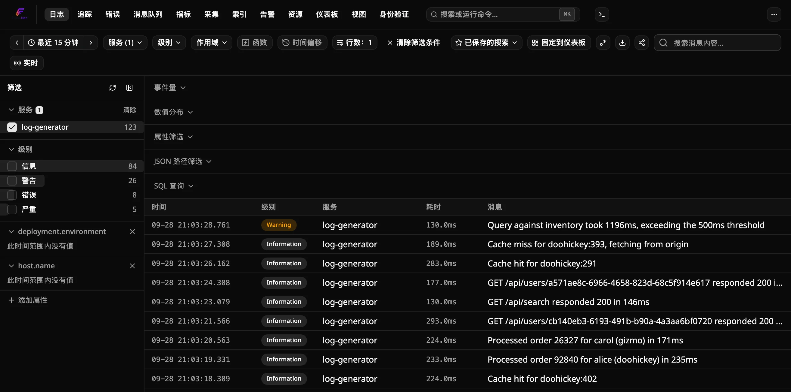

### 追踪

`/traces` —— Flare 收到的每一条 OTLP 追踪，可按服务和时间范围过滤。自动插桩的 span（ASP.NET Core、HttpClient 等）和你自己的代码通过 `ActivitySource` 发出的 span 并排显示。列表默认按时间从新到旧排列；点击“时间”“耗时”或“跨度数”列标题即可按该列排序（再次点击反转顺序），例如查看时间范围内最慢的请求，或跨度最多的追踪。

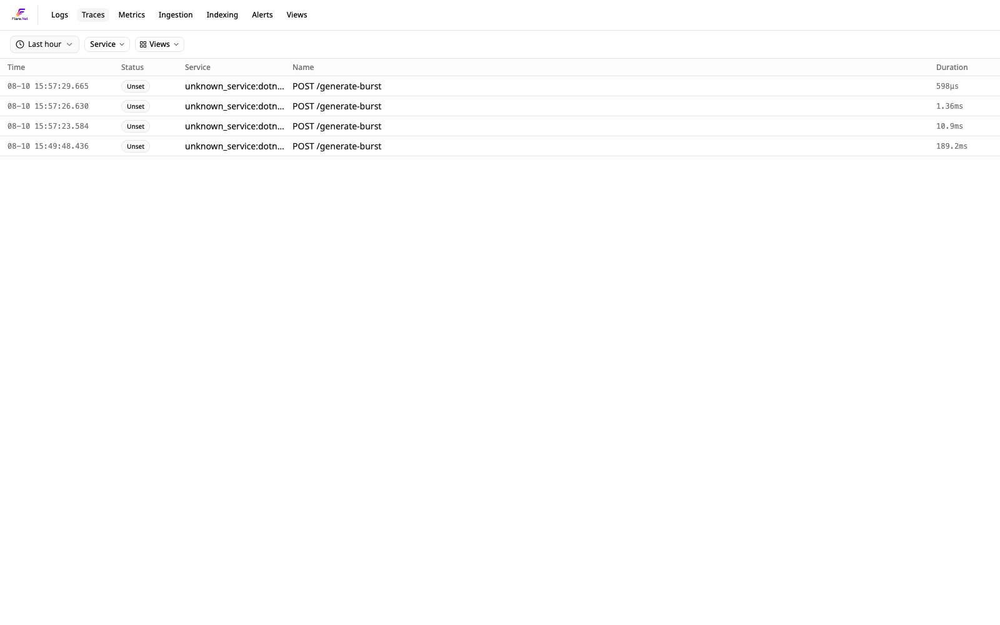

点击一条追踪进入瀑布视图 —— 父/子 span 按开始时间和耗时排布，形态与 Jaeger/Zipkin 相同，但直接连通仪表板的其余部分。span 事件会以圆点形式显示在 span 条上事件发生的时刻（异常为红色）；将鼠标悬停在圆点上可查看其名称、时间偏移和关键属性。“火焰图”标签页以火焰图形式展示同样的 span（宽度 = 耗时，按深度堆叠，按服务着色），一眼看出大型追踪的时间花在了哪里；单击 span 查看详情，双击放大到该 span。在这两个视图中，“搜索 span”框可按名称、服务、span ID 或属性（也支持 `键=值`）查找 span：匹配项会高亮，其余变暗，按 Enter / Shift+Enter 在匹配项之间跳转，并沿途展开已折叠的父 span。

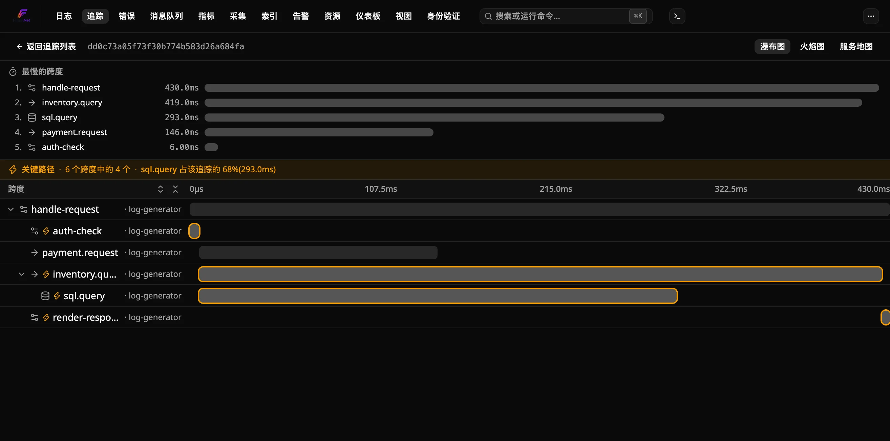

追踪列表旁的“Services”标签页提供按服务汇总、可排序的 RED 指标（请求速率、错误率、p50/p95/p99 延迟），由同一批 span 推导而来，使用自己可选的时间窗口（5 分钟到 24 小时），每 10 秒刷新一次。它回答“现在哪个服务不健康”，而无需在追踪搜索或指标选择器里手工构造等价的查询。这里的“请求”指根 span（`ParentSpanId` 为空）—— 即服务的追踪入口点，与追踪列表自身“每条追踪一行”的约定一致。点击服务名称可回到追踪列表，并预先按该服务和时间窗口过滤。这个汇总读取的是写入时填充的表，而不是每次刷新都扫描 span（[ADR-0030](../../docs-internal/adr/0030-service-red-metrics-pre-aggregation.md)），服务依赖图和调用分解也采用同样的思路（[ADR-0031](../../docs-internal/adr/0031-service-map-breakdown-pre-aggregation.md)）。

“漏斗”标签页（`/traces/funnels`）让追踪依次经过一组有序步骤（每个步骤按服务、span 名称和属性过滤条件匹配 span），显示到达每个步骤的追踪数、在哪一步流失、每个步骤的错误数以及步骤之间的延迟。点击任一数字即可查看对应的追踪。结果在查询时根据已存储的 span 计算，漏斗以普通的已保存视图形式保存。参见 [`../how-to/investigate/analyze-trace-funnels.zh-CN.md`](../how-to/investigate/analyze-trace-funnels.zh-CN.md) 和 [ADR-0067](../../docs-internal/adr/0067-trace-funnels.md)。

追踪列表工具栏中的“结构”按钮按追踪内 span 之间的关系进行筛选：带字母的 span 条件通过 `A -> B`（直接子 span）、`A => B`（任意层级的后代）、AND、OR 和 NOT 组合，例如“一个 `checkout` span，其后代中有出错的 `payment` span”。它是 `SpanFilter` 的一个字段，在查询时作为按 `TraceId` 的子查询计算，因此列表、分面、已保存视图和仪表板面板都会遵循它。参见 [`../how-to/investigate/find-traces-by-structure.zh-CN.md`](../how-to/investigate/find-traces-by-structure.zh-CN.md) 和 [ADR-0069](../../docs-internal/adr/0069-structural-trace-queries.md)。

还有两个视图读取同样的 span。“N+1”视图列出这样的追踪：同一个父 span 执行了 10 条或更多相同的数据库语句（参见 [`../how-to/investigate/find-n-plus-one-queries.zh-CN.md`](../how-to/investigate/find-n-plus-one-queries.zh-CN.md)）；span 的详情还可以显示它的耗时相对于*这类 span*是否偏慢（参见 [`../how-to/investigate/compare-span-duration.zh-CN.md`](../how-to/investigate/compare-span-duration.zh-CN.md)）。

### 错误

`/errors` —— 按异常类型和规范化消息（ID、数字和引号内的值被折叠）分组的异常，显示计数、出现的服务和版本，以及一份示例堆栈跟踪。每个分组都有生命周期：标记为已解决或已忽略、指派给某人、关联到你的问题跟踪器中的工单，而当一个“已修复”的错误再次出现（回归）时，Flare 会告诉你。归属规则（按服务、异常类型或源文件路径）把分组分配给合适的人，堆栈帧可以链接到你仓库中的确切行，也可以内联显示源码。列表由记录在 span 上的 `exception` 事件构建，因此任何会把异常记录到 span 上的 OTLP 发送方都能使用。参见 [`../how-to/investigate/triage-errors.zh-CN.md`](../how-to/investigate/triage-errors.zh-CN.md)、[`../how-to/investigate/link-exceptions-to-source-code.zh-CN.md`](../how-to/investigate/link-exceptions-to-source-code.zh-CN.md) 和 [ADR-0121](../../docs-internal/adr/0121-error-issue-lifecycle.md)。

### 发布

`/releases` —— 标记某个服务的一个版本已经发布（通过你的流水线，使用个人访问令牌），Flare 会按版本列出首次出现在该版本中的异常分组，在图表上绘制发布标记，并在某次发布引入错误时告警。要并排比较一个服务的两个版本（延迟、错误、吞吐量、新异常和新的出站依赖），请从 Traces 的 Services 标签页打开该服务。参见 [`../how-to/investigate/track-releases.zh-CN.md`](../how-to/investigate/track-releases.zh-CN.md)、[`../how-to/investigate/compare-deploys.zh-CN.md`](../how-to/investigate/compare-deploys.zh-CN.md) 和 [ADR-0182](../../docs-internal/adr/0182-release-tracking.md)。

### 前端

`/frontend` —— 浏览器应用通过 OpenTelemetry JavaScript SDK 上报的内容：页面加载、路由切换、Core Web Vitals 和 JavaScript 错误，并借助上传的 source map 把压缩后的堆栈跟踪映射回源码。浏览器的 span 与你的后端共享 trace ID，所以一次缓慢的点击可以一路追踪到 API 调用及其查询。浏览器向 OTLP/HTTP 接收器发送数据，因此可以把摄取密钥限制在允许使用它的来源上。参见 [`../how-to/instrument/send-browser-telemetry.zh-CN.md`](../how-to/instrument/send-browser-telemetry.zh-CN.md) 和 [ADR-0153](../../docs-internal/adr/0153-frontend-page-and-source-map-settings.md)。

### 会话

`/sessions` —— 来自 `Flare.Maui` 的每个应用会话一行：设备、操作系统和应用版本，是否以崩溃或卡死结束，每个会话的屏幕、面包屑、网络调用和错误的时间线，可选的截图和用户反馈，以及启动和屏幕加载性能。该页面还显示发布健康度：每个应用版本的无崩溃会话和用户占比（[ADR-0175](../../docs-internal/adr/0175-release-health.md)）。参见 [`../how-to/instrument/send-maui-telemetry.zh-CN.md`](../how-to/instrument/send-maui-telemetry.zh-CN.md)、[`../tutorials/monitor-a-maui-app.zh-CN.md`](../tutorials/monitor-a-maui-app.zh-CN.md) 和 [ADR-0167](../../docs-internal/adr/0167-app-sessions-view.md)。

### 消息队列

`/messaging` —— 每个 Kafka 主题、RabbitMQ 队列、NATS 主题或 Service Bus 实体（包括 MassTransit 消息类型）一行，显示发布和消费速率、错误率、p99 延迟，以及积压：待处理消息，具体为 Kafka 消费者延迟、RabbitMQ 队列深度、NATS JetStream 待处理消息、Service Bus 活动消息或 SQS 可见消息。速率和延迟在查询时根据生产者和消费者 span 的 OTel `messaging.*` 属性计算，无需额外的代理或数据表；积压则来自你的消息代理或 Collector 已经导出的指标（例如它的 `kafkametrics` 或 `rabbitmq` 接收器），有则读取。点击一行可查看其生产者、消费者、分区、按消费者组的延迟或按队列的深度。参见 [`../how-to/monitor/monitor-message-queues.zh-CN.md`](../how-to/monitor/monitor-message-queues.zh-CN.md)、[ADR-0056](../../docs-internal/adr/0056-messaging-queue-monitoring.md) 和 [ADR-0057](../../docs-internal/adr/0057-rabbitmq-queue-depth.md)。

### 外部 API

`/external-apis` —— 你的服务调用的每个外部域名一行，显示速率、错误率、p95/p99 延迟、端点数和最近出现时间。数据在查询时根据 `CLIENT` span 的 `server.address`（否则取 `net.peer.name`，再否则取 URL 的主机名）计算，不含数据库和消息调用。点击域名可查看其端点（方法加 `url.template`，或将类似 ID 的路径段合并为 `{id}` 的 URL 路径）、状态码、主要错误和调用方服务，每项都链接到匹配的追踪。当 span 没有 `peer.service` 时，服务分解的 External calls 标签页也回退到同一域名。服务地图会为每个出站调用到达、但没有被插桩的子 span 的主机增加一个叶子节点，这些数据来自 `outbound_calls` 表（迁移 0035），并与 span 的父 ID 做反连接。参见 [`../how-to/monitor/monitor-external-apis.zh-CN.md`](../how-to/monitor/monitor-external-apis.zh-CN.md)、[ADR-0071](../../docs-internal/adr/0071-external-api-monitoring.md) 和 [ADR-0072](../../docs-internal/adr/0072-external-host-map-leaves.md)。

### LLM

`/llm` —— 你的服务如何使用语言模型，数据来自遵循 OpenTelemetry GenAI 约定的 span：按提供方和模型显示调用速率、错误率、延迟以及输入和输出 token，并根据价格表给出估算成本，一键即可打开匹配的追踪。预聚合表保证了速度。参见 [`../how-to/monitor/monitor-llm-calls.zh-CN.md`](../how-to/monitor/monitor-llm-calls.zh-CN.md)、[ADR-0100](../../docs-internal/adr/0100-llm-observability-genai-spans.md) 和 [ADR-0101](../../docs-internal/adr/0101-llm-estimated-cost.md)。

### 性能剖析

`/profiles` —— 持续性能剖析：用火焰图展示 CPU 时间或内存花在哪里，数据来自与其他信号相同端口上的 OTLP profiles 信号。OTLP profiles 在 OpenTelemetry 中仍是 Alpha，目前很少有发送方会产生它，所以请把这个页面当作早期功能。参见 [`../how-to/investigate/profile-with-continuous-profiling.zh-CN.md`](../how-to/investigate/profile-with-continuous-profiling.zh-CN.md) 和 [ADR-0141](../../docs-internal/adr/0141-continuous-profiling-ingest.md)。

### 指标

`/metrics` —— 你的服务上报的每个 OTLP 指标仪器（Sum、Gauge、Histogram、指数 Histogram），可从可搜索的侧边栏浏览，并为每个仪器渲染一张时间序列图表。既涵盖免费的 `AddAspNetCoreInstrumentation()`/`AddRuntimeInstrumentation()` 数据（.NET GC、线程池、Kestrel、HTTP 客户端/服务端），也涵盖你自己的 `Meter` 发出的任何内容。图表支持分组、跨查询公式、速率、平滑和时间平移等函数，以及把某个点关联到追踪的 exemplar 圆点。计数器以考虑重置的速率或增量显示。Catalog 视图（`/metrics/catalog`）列出每个指标的类型、单位、描述和序列数，可以覆盖单位或描述，并帮助找出高基数指标。Prometheus 抓取目标和基于日志的指标落入同样的表，所以它们的绘图和告警方式相同。在 Grafana 中读取同样的数据，见[集成](#集成与-api)。

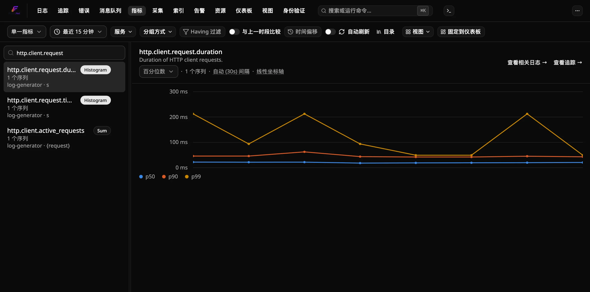

### 仪表板

`/dashboards` —— 你自己的面板看板。面板可以是针对日志、追踪或指标的图表（时间序列、柱状图、数值、饼图、表格、直方图和热力图）、跨指标查询的公式，或文本。看板支持变量（多值，并可串联，使一个变量从另一个取值）、可折叠的行、标签、首页仪表板的选择、面板阈值，以及所有者，所以一个人的看板不会被别人悄悄改掉。看板可以复制、导出为 JSON、导出为 Grafana JSON、从内置模板开始，并可按计划通过邮件发送。点击面板会在日志、追踪或指标浏览器中打开同一个查询。参见 [`../how-to/dashboards/build-custom-dashboards.zh-CN.md`](../how-to/dashboards/build-custom-dashboards.zh-CN.md)、[`../how-to/dashboards/schedule-dashboard-reports.zh-CN.md`](../how-to/dashboards/schedule-dashboard-reports.zh-CN.md)、[`../tutorials/first-dashboard.zh-CN.md`](../tutorials/first-dashboard.zh-CN.md) 和 [ADR-0023](../../docs-internal/adr/0023-custom-dashboards.md)。

### Resources、Hosts 和 Kubernetes

三个页面分别面向服务之下的基础设施，回答不同的问题：

- **Resources**（`/resources`）—— Flare 自己发现的内容：它自己的 Docker 容器或 Kubernetes pod，以及它所运行的机器。在 Docker Compose 中需要一个可选的只读 Docker socket 代理，不启用就不会运行（[ADR-0005](../../docs-internal/adr/0005-docker-socket-proxy-for-resources-page.md)）；在 Kubernetes 上，它通过仅限于 pod 和 service 的 RBAC 读取这两类资源（[ADR-0006](../../docs-internal/adr/0006-kubernetes-resource-graph-rbac-scoping.md)）。
- **Hosts**（`/hosts`）—— 每台自行上报 `hostmetrics` 的机器一行：CPU、内存、磁盘和负载，每个指标都有下钻图表。参见 [`../how-to/monitor/monitor-hosts.zh-CN.md`](../how-to/monitor/monitor-hosts.zh-CN.md)。
- **Kubernetes**（`/kubernetes`）—— 由 Collector 的 `kubeletstats` 和 `k8s_cluster` 接收器所上报的集群，分为 Nodes、Namespaces、Workloads、Pods 和 Volumes 标签页，并可从 pod 链接到它的日志。参见 [`../how-to/monitor/monitor-kubernetes.zh-CN.md`](../how-to/monitor/monitor-kubernetes.zh-CN.md)。

### 摄取

`/ingestion` —— OTLP 接收器本身的运行可见性：当前的到达/摄取速率，按信号（日志/追踪/指标）× 按协议（gRPC/HTTP）划分的请求、事件和字节数，以及 Flare 拒绝的所有内容（错误的负载、不支持的媒体类型）及原因的摄取日志。如果“我的日志没显示出来”，首先该检查的页面。

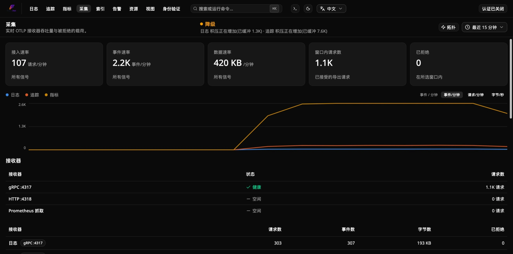

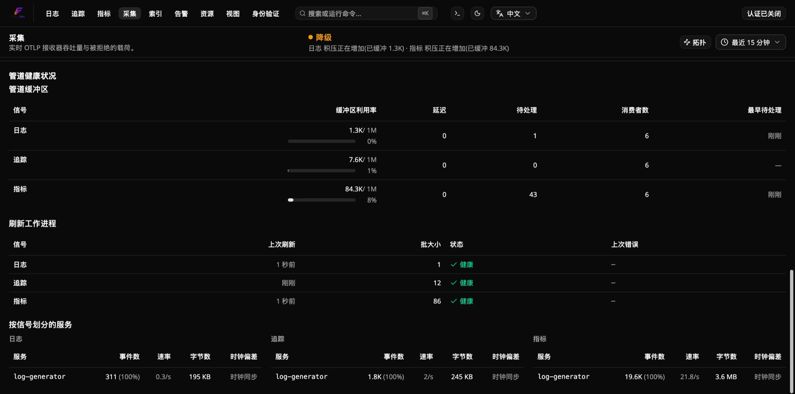

### 告警

`/alerts` —— 基于与各浏览器相同的过滤条件和查询的告警规则：凡是能搜索的，都能设成告警。规则的条件是下列之一：

- **日志数量**（一个已保存的日志过滤条件加上滚动窗口上的计数阈值）；
- **指标阈值**（把指标查询与一个值比较，Gauge 可用 Last/Min/Max，计数器使用考虑重置的增量）；
- **异常数量**；
- **异常检测**，与前几天或前几周的同一窗口对比打分（[ADR-0048](../../docs-internal/adr/0048-anomaly-detection-alerting.md)）；
- **SLO 燃烧率**，当某个 SLO 的错误预算在长、短两个窗口内都消耗过快时触发（[`../how-to/alerting/define-slos.zh-CN.md`](../how-to/alerting/define-slos.zh-CN.md)、[ADR-0108](../../docs-internal/adr/0108-slo-error-budgets.md)）；
- **发布错误**，当某次发布引入新的异常分组时触发，以及针对移动端版本的**无崩溃率**。

每条规则都有冷却时间，并可在保存前“针对当前数据进行测试”做试运行。默认情况下，每条规则在告警 worker 的每个轮询周期（30 秒）都会被检查；对于较慢或开销较大的规则，可以设置其自身的“Evaluate every”间隔（1 分钟到 1 小时）。规则还可以：

- 要求指标规则的窗口内至少有一定数量的数据点；数据点不足时，规则会报告数据不足且不会触发；
- 在没有数据时告警，即条件完全没有匹配到任何数据；
- 设置恢复阈值（例如在 90% 触发，低于 80% 恢复），这样在阈值附近徘徊的数值不会在触发与恢复之间反复切换；
- 带有严重级别（critical、error、warning 或 info，默认 critical），会作为 PagerDuty 的 severity 发送，显示在其他渠道的通知中，并可在模板中用 `{{severity}}` 引用；
- 使用与指标不同的单位填写阈值（例如对以秒记录的指标填写 `500 ms`），每次比较前都会先换算（参见 [ADR-0080](../../docs-internal/adr/0080-alert-threshold-unit.md)）；
- 带有自己的键值标签（如 `team=payments`），可在规则列表中筛选，并可通过 `{{labels.team}}` 和 webhook 负载使用（参见 [ADR-0084](../../docs-internal/adr/0084-alert-rule-labels.md)）。

规则可以用模板覆盖通知的标题和正文，模板可使用 `{{value}}`、`{{threshold}}`、`{{logs_url}}`、`{{log_samples}}`（日志数量告警中最新的匹配日志行）或 `{{labels.service.name}}` 等占位符，并在规则表单中实时预览。模板可以通过 Settings > Workspace > Alert templates 在多条规则之间共享。配置了公开 URL 时，每条通知都会链接到触发告警的数据：匹配的日志、指标图表或匹配的异常，范围为规则的过滤条件和所评估的时间窗口（模板中使用 `{{data_url}}`），并且可以带上签名的确认链接（`{{ack_url}}`）。

规则触发之后会发生什么：

- **通知。** 一条规则会通知一个或多个通知渠道，这些渠道在 Settings > Workspace > Channels 中管理（也可以通过规则表单中的“New channel”按钮当场创建）：可复用的命名目标，规则通过 ID 引用它们而不是直接内联，因此同一个渠道可以在多条规则间复用，一条规则也可以针对同一次告警同时通知多个目标（参见 [ADR-0021](../../docs-internal/adr/0021-reusable-notification-channels.md)）。渠道类型有 webhook/Slack、Telegram、电子邮件、PagerDuty、Microsoft Teams、Discord、Jira、incident.io 和 Jira Service Management Ops。在渠道功能上线前创建的规则仍会通过其自身的内联渠道通知，行为不变。请参阅 [`../../src/Flare.Api/README.md`](../../src/Flare.Api/README.md#alerting) 了解每种渠道类型需要在服务器端配置的内容。
- **确认或暂缓。** 触发中的规则可以从仪表板、CLI 或通知本身确认或暂缓，从而静音重复通知；未确认的告警可以通过后续步骤和值班轮换升级（参见 [`../how-to/alerting/acknowledge-and-snooze-alerts.zh-CN.md`](../how-to/alerting/acknowledge-and-snooze-alerts.zh-CN.md) 和 [ADR-0124](../../docs-internal/adr/0124-alert-acknowledgement-and-snooze.md)）。
- **恢复。** 已触发的规则恢复正常时，其渠道会收到一条“Resolved”通知，PagerDuty 事件也会自动关闭。每个渠道都可以通过“发送恢复通知”开关选择不接收此类通知。规则历史会在触发记录旁边记录这次恢复（参见 [ADR-0064](../../docs-internal/adr/0064-alert-resolved-notifications.md)）。
- **静默。** 每条规则行都有“静默”操作（15 分钟到 1 周，或指定截止时间，可附原因），会为该规则创建一次性窗口；该行显示“已静默至 …”，点击“取消静默”可提前结束。Settings > Workspace > Maintenance windows 可以为所有规则、选定规则或带某个标签的规则安排一次性、每天或每周的维护窗口（使用所选时区），因此之后新建的规则会自动被覆盖。窗口期间规则仍会评估，但告警会作为“已抑制”记录在规则历史中，而不会发送通知（参见 [ADR-0055](../../docs-internal/adr/0055-alert-maintenance-windows.md)）。
- **摘要。** 配置了 AI 提供方后，触发的告警可以得到一段通俗易懂的摘要（参见 [`../how-to/alerting/summarize-alerts-with-ai.zh-CN.md`](../how-to/alerting/summarize-alerts-with-ai.zh-CN.md)）。

告警规则可以导出和导入为 JSON（或使用 `flare alerts export` / `import`），以便放进 git 管理。这一切背后的模型，参见[告警如何工作](how-alerting-works.zh-CN.md)。

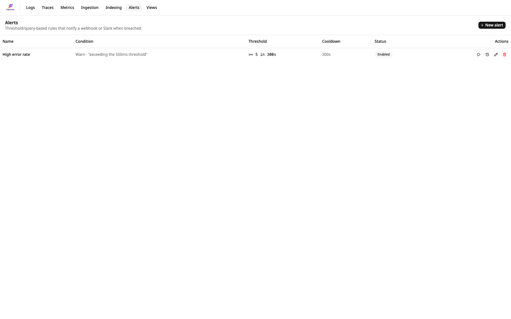
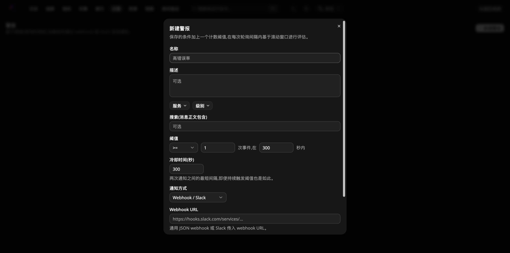

### 视图

`/views` —— 从日志、追踪或指标工具栏的“视图”控件保存的命名、可重新加载的过滤器。保存过滤器一次（例如“提及超时的警告”），然后从此处或该页面自己的“视图”下拉列表重新加载它 —— 可通过链接共享，不与创建它的人绑定。每个浏览器还会在下次打开时回到你上次使用的视图。

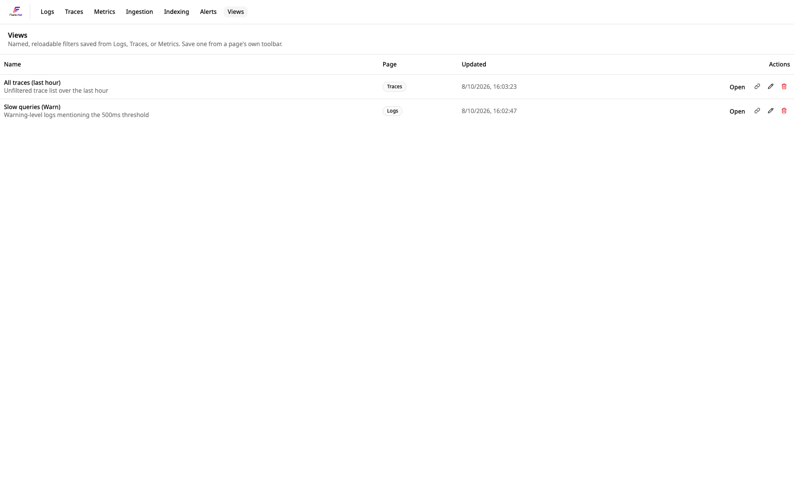

### 状态页

状态页（`/status/<slug>`）是只读的服务健康页面，任何拿到链接的人都能打开，无需账户：显示每个组件的当前状态和每日可用率、已发布的事件，以及可选的邮件订阅，并采用你自己的品牌和域名。组件可以是[合成监控](../how-to/monitor/synthetic-monitoring.zh-CN.md)（告警 worker 按计划从一个或多个位置运行的 HTTP、TCP、TLS 证书、DNS、UDP 或 ICMP 探测）或 [SLO](../how-to/alerting/define-slos.zh-CN.md)，并以你选定的公开名称显示。页面在 Settings > Workspace 下管理。参见 [`../how-to/monitor/publish-a-status-page.zh-CN.md`](../how-to/monitor/publish-a-status-page.zh-CN.md) 和 [ADR-0158](../../docs-internal/adr/0158-status-pages.md)。

### 数据源

从导航栏的下拉菜单进入，或者在日志页面为空时点击“查看如何摄取数据”，正好是需要它的时候。这是一个可搜索的、复制粘贴式的 OTLP 配置片段目录，按平台（Kubernetes、Docker、Linux、Windows）、语言/SDK（.NET、Python、Node.js、Java、Go）、日志转发工具（Vector、Fluent Bit、Syslog）、CI/DevOps 工具（Jenkins、Ansible、Terraform、GitHub Actions）分类，另有一个原始 HTTP/JSON 兜底方案 —— 加上归类在“指标”下的一个 Prometheus 条目，对应 `Flare.Ingest` 原生的抓取接收器，是此处唯一一个拉取而非推送的条目。每个片段的主机/端口都取自浏览器自身的来源，因此复制出来的内容匹配你的实际部署，而不是占位符 —— 这与 README 中“.NET 专用”片段所指向的是同一个目录，覆盖了其他所有语言或平台。

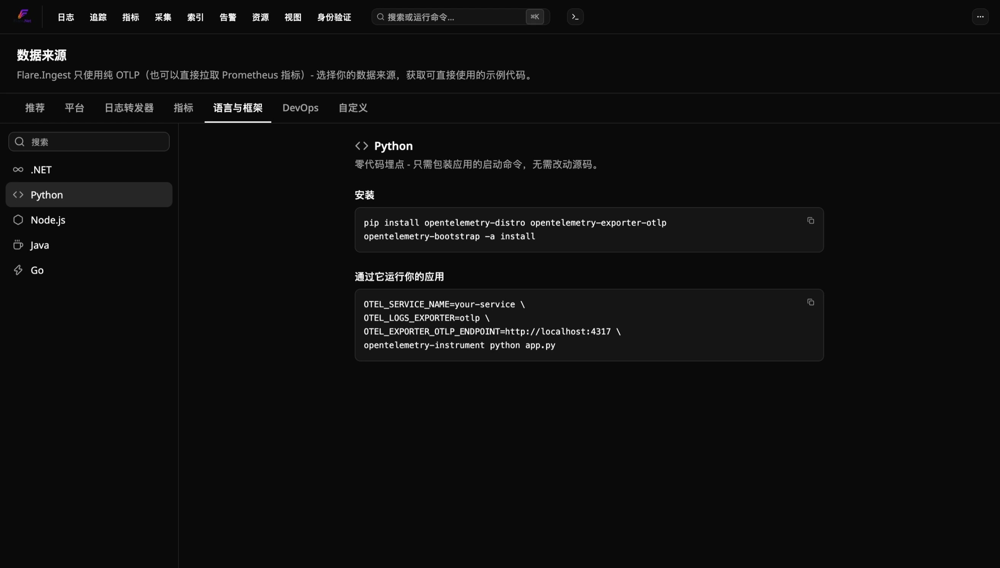

### 设置

配置位于 **Settings**（`/settings`）下，这是一个带左侧栏和搜索框的页面，分为三组：

- **个人** —— 外观（主题）、语言和显示时区、浏览器默认设置、键盘快捷键、浏览器告警通知，以及你的账户。对所有人开放。
- **管理** —— SLO、管道规则（在摄取时提取或脱敏字段）、基于日志的指标，以及你的个人访问令牌。
- **Workspace** —— 实例级页面，需要 Admin 角色（或关闭认证）：

| 范围 | 涵盖内容 |
|---|---|
| 告警 | 通知渠道、维护窗口、共享告警模板、值班轮换 |
| 监控 | 合成监控、状态页 |
| 数据 | 保留与冷存储、擦除和导出某个人的数据、遥测导出（OTLP 转发和 S3 归档）、Usage |
| 索引 | 让底层的 ClickHouse 存储变得可见：总存储（压缩/未压缩）、行数、逐表细分（`logs`、`spans`、`metrics_sum` 等）及压缩率、过去 30 天的增长，以及支撑快速过滤的跳过索引。在集群模式下，这里也是集群面板所在的位置 —— 参见 [`clustering.md`](clustering.zh-CN.md#仪表板索引页面上的集群状态) |
| 访问 | 项目（团队的服务允许列表）、摄取密钥（带来源和服务允许列表、限额和过期时间）、source map、审计日志 |

Auth 页（`/auth`）是管理员开启认证并选择认证方式的地方：本地账户、Microsoft Entra ID、Active Directory（LDAP）、OpenID Connect，或来自反向代理的受信任请求头。参见[认证模型](authentication-model.zh-CN.md)和[项目与访问范围](projects-and-access-scoping.zh-CN.md)。索引、保留和用量合在一起回答“磁盘被什么占用了”：参见 [`../how-to/data/see-what-drives-storage.zh-CN.md`](../how-to/data/see-what-drives-storage.zh-CN.md) 和[保留与分层](retention-and-tiering.zh-CN.md)。

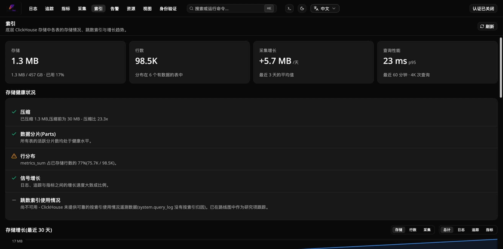

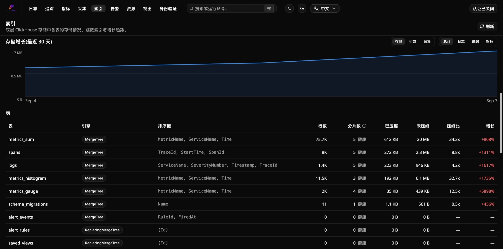

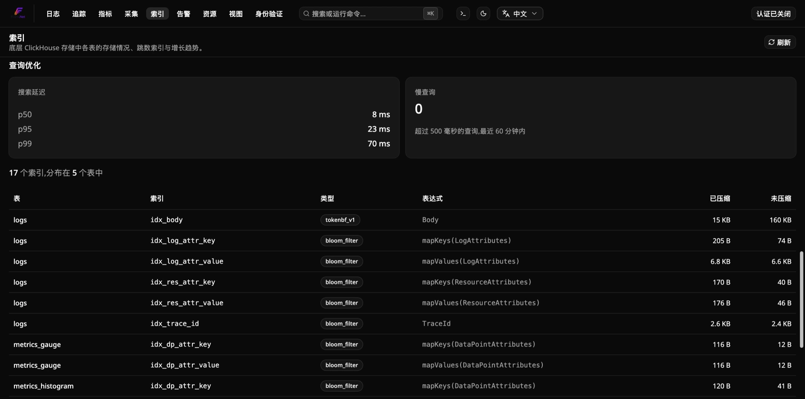

## 集成与 API

Flare 的定位是与你已在使用的工具并存，而不是一次性取代它们全部：

- **AI 助手。** 只读的 [MCP](../how-to/integrations/connect-ai-assistants.zh-CN.md) 服务器向 Claude Code、Cursor 和 VS Code 开放日志、追踪、指标和告警，既可通过 `flare mcp` 走 stdio，也可作为 `Flare.Api` 上的流式 HTTP 端点（`/mcp`）。
- **Grafana。** Flare 的 API 能响应只读的 Prometheus（[ADR-0109](../../docs-internal/adr/0109-prometheus-query-api.md)）、Tempo（[ADR-0217](../../docs-internal/adr/0217-tempo-compatible-trace-api.md)）和 Loki（[ADR-0236](../../docs-internal/adr/0236-loki-compatible-log-api.md)）查询，因此 Grafana 可以把它当作这些数据源，包括 Metrics、Traces 和 Logs Drilldown 应用。[Flare 数据源插件](../how-to/integrations/query-with-grafana-plugin.zh-CN.md)增加了会话、错误和发布健康度，仪表板也可以导出为 Grafana JSON。
- **向下游输出。** Flare 可以把摄取的数据转发到另一个 OTLP 端点（[ADR-0155](../../docs-internal/adr/0155-otlp-forwarding.md)），并以 Parquet 或 NDJSON 格式归档到兼容 S3 的存储（[ADR-0156](../../docs-internal/adr/0156-telemetry-archive-s3.md)）。
- **配置即代码。** `flare config export` 和 `flare config apply` 通过 git 迁移规则和设置，Terraform/OpenTofu provider 则以声明方式管理它们（[ADR-0146](../../docs-internal/adr/0146-terraform-provider.md)）。

## 为什么 CLI 固定镜像标签而不是跟踪 `latest`

`Flare.Cli` 托管的实例默认使用经过测试的特定 `vX.Y.Z` 镜像标签，而不是浮动的 `edge`/`latest` 标签（确切的默认值和版本历史请参阅[参考文档](../reference/cli-commands.zh-CN.md#图片标签政策)）—— 这是有意为之，使某个 `Flare.Cli` 版本永远拉取相同的镜像，直到你显式更改。`flare update`（不带 `--tag`）重新拉取同一个固定标签，而不是自动发现更新的版本，并且有意永远不会这样做：只有这个 CLI 的作者知道哪些较新的 Flare Docker 镜像确实已针对某个 `Flare.Cli` 版本测试过 —— Docker Hub 上存在更新的标签并不等于这一点。每个新的 `Flare.Cli` 版本在针对较新的 Flare 镜像测试之后，会重新固定其自身模板的默认值；现有安装继续跟踪它们生成时所用的标签，直到你用 `flare update --tag TAG` 显式更改。

## 为什么 CLI 托管的实例使用随机密码

仓库自带的 `docker-compose.yml` 使用有文档说明的 `flare`/`flare` 默认密码 —— 对于你搭建、评估后就拆除的堆栈来说没问题。`Flare.Cli` 托管的实例则是要常驻数周，端口一直绑定在你的机器上，而不是快速评估后就拆除，因此为长期运行的东西复用一个公开的、有文档记载的默认密码，是 CLI 默认不会踩的坑。密码在首次初始化时生成一次，之后不再轮换（轮换会在下次启动时破坏 `identity-data`/ClickHouse 的认证）—— 该文件是纯文本，如果你想设置自己的值，可以手动编辑。
